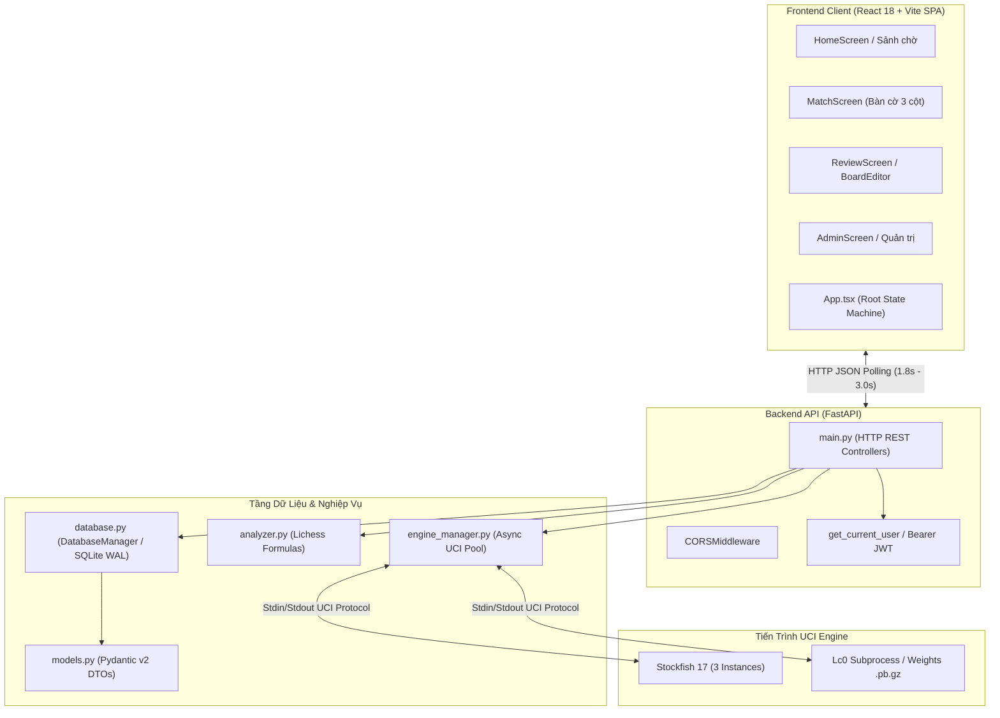

# Báo Cáo Kỹ Thuật Toàn Diện (Comprehensive Codebase Audit Report)
## Dự Án: TheChess — Studio Phân Tích & Thi Đấu Cờ Vua Nội Bộ

- **Đơn vị thực hiện:** Lead Software Architect, Security Auditor & Senior Product/UX Specialist
- **Ngày thực hiện kiểm toán:** 30/10/2026
- **Phạm vi kiểm toán:** Toàn bộ repository (`backend/`, `frontend/`, `engines/`, `docs/`, `run.sh`, cấu hình hệ thống)
- **Phiên bản hệ thống:** Backend API `v3.0.0` (FastAPI + SQLite WAL + Async Engine Pool) · Frontend `Multiplayer V3 + Design System V1 ("Phòng học cờ")`
- **Tổng quy mô mã nguồn:** ~11.500 dòng code (LOC) / 38 tệp nguồn (Python 3.12, TypeScript 5.6, React 18.3, TailwindCSS 3.4, SQL DDL)

---

## 1. Executive Summary

### 1.1. Tóm tắt tổng quan ứng dụng
`TheChess` là một nền tảng cờ vua tự vận hành (self-hosted club & study studio), phục vụ ba mục tiêu cốt lõi:
1. **Thi đấu trực tuyến nội bộ (LAN / VPS):** Phục vụ các câu lạc bộ, trường học, gia đình hoặc đội nhóm thi đấu PvP với đồng hồ Fischer, phòng chờ tự sinh mã (Room Code), và Sảnh trực tiếp (Lobby & Spectator Live Stream).
2. **Đối kháng AI phỏng theo con người & Đỉnh cao:** Tích hợp mạng nơ-ron **Maia Chess** (mô phỏng nước đi con người theo các dải Elo 1100–1900) và **Stockfish 17 NNUE** (cường độ từ 1320 Elo tới mức kiện tướng 3190 Elo).
3. **Phân tích thế cờ & Chấm điểm toàn diện (Game Review):** Phân tích thời gian thực (MultiPV, Win%, Đổi biến nhánh phụ) và chấm điểm sau ván đấu (chấm độ chính xác Accuracy %, phân loại nước đi: Best, Excellent, Good, Inaccuracy, Mistake, Blunder theo chuẩn Lichess).

**Core Tech Stack:**
- **Backend:** Python 3.12, FastAPI 0.110+, SQLite 3 (WAL mode), `python-chess` 1.10+, Pydantic v2, `asyncio` Subprocess Engine Pool.
- **Frontend:** React 18.3, TypeScript 5.6, Vite 5.4, TailwindCSS 3.4, `react-chessboard` 4.7, `chess.js` 1.0-beta.8, `lucide-react`, Typography fonts (`@fontsource/fraunces`, `@fontsource/ibm-plex-mono`).

---

### 1.2. Điểm đánh giá tổng hợp theo thang điểm 10

| Khía cạnh đánh giá | Điểm số (Thang 10) | Trọng số | Điểm có trọng số | Nhận định tóm tắt |
|---|:---:|:---:|:---:|---|
| **1. Kiến trúc (Architecture)** | **7.5 / 10** | 20% | 1.50 | Backend Modular Monolith + Subprocess Worker Pool phân tầng tốt. Điểm trừ: Frontend `App.tsx` quá lớn (>2.200 LOC) và kiến trúc sync phụ thuộc HTTP Polling. |
| **2. Tính năng (Features)** | **8.8 / 10** | 20% | 1.76 | Bộ tính năng rất phong phú, bám sát luật cờ FIDE, hỗ trợ soft-branching, phân tích nước đi, đồng hồ Fischer, Admin portal hoàn chỉnh. |
| **3. Chất lượng mã nguồn (Code Quality)** | **7.2 / 10** | 15% | 1.08 | Code Python clean, type-safe với Pydantic v2. Test coverage backend tốt ở DAL và Analyzer (`38/38 passed`), nhưng thiếu Integration test cho API và UI component. |
| **4. UI/UX & Frontend** | **8.5 / 10** | 15% | 1.28 | Design System "Phòng học cờ" xuất sắc, giao diện 3 cột cân đối, responsive mượt mà. Cần bổ sung focus trapping và aria-live cho a11y. |
| **5. Bảo mật (Security)** | **5.5 / 10** | 15% | 0.83 | **Tồn tại lỗ hổng Broken Access Control (IDOR) nghiêm trọng** ở API ghi nước đi, takeback và kết thúc trận. Secret key có fallback hardcoded. |
| **6. Hiệu năng (Performance)** | **6.8 / 10** | 15% | 1.02 | Engine pool và LRU cache FEN tối ưu tốt. Tuy nhiên SQLite bị RLock toàn cục làm mất ưu thế WAL; tồn tại N+1 query ở Sảnh; bundle client chưa code splitting (494 kB). |
| **TỔNG HỢP TOÀN DIỆN** | **7.47 / 10** | **100%** | **7.47 / 10** | **Xếp loại: KHÁ TỐT (B+) — Sẵn sàng production sau khi vá lỗi bảo mật P0.** |

---

### 1.3. Các rủi ro cấp bách (Critical Issues - P0) cần xử lý ngay lập tức

1. **[Bảo mật - P0] Lỗ hổng Broken Access Control / IDOR trong API Ván đấu (`backend/main.py`):**
   - Các endpoint `POST /api/matches/{match_id}/move`, `POST /api/matches/{match_id}/takeback`, `POST /api/matches/{match_id}/finish`, và `POST /api/matches/{match_id}/save-review` có nhận `user: UserRecord = Depends(get_current_user)`, nhưng **hoàn toàn không xác thực xem `user.id` có phải là người chơi (White hoặc Black) của ván đấu đó hay không**.
   - Bất kỳ người dùng đã đăng nhập nào (kể cả khán giả hoặc đối thủ lạ) cũng có thể gửi request để đi cờ thay, takeback, hoặc tự ấn định kết quả thắng thua `1-0` làm sai lệch điểm Elo của người khác.

2. **[Bảo mật - P0] Fallback Secret Key Hardcoded & Mật khẩu Admin mặc định (`backend/database.py`):**
   - Biến `SECRET_KEY` fallback về chuỗi tĩnh: `"thechess-club-secret-signing-key-2026"`. Nếu người vận hành chạy ứng dụng mà quên cấu hình biến môi trường `THECHESS_SECRET_KEY`, bất kỳ ai đọc mã nguồn cũng có thể ký giả mạo token JWT của quyền Admin.
   - Tài khoản Admin mặc định tự động seed với username `admin` và mật khẩu `admin123456` nếu thiếu cấu hình env.

3. **[Độ tin cậy - P0] Sai lệch đồng hồ Fischer do Clock Drift khi tab trình duyệt chạy nền (`frontend/src/App.tsx`):**
   - Đồng hồ Fischer phía client đếm lùi bằng `window.setInterval(..., 250)` trừ cố định 250ms. Khi người dùng chuyển tab hoặc thu nhỏ cửa sổ, cơ chế background throttling của Chrome/Firefox/Safari sẽ giảm tần số timer xuống 1.000ms hoặc thấp hơn, khiến đồng hồ của kỳ thủ chạy chậm gấp 4 lần thực tế và tự xử thua hết giờ không đồng bộ với thời gian thực.

---

## 2. Kiến trúc & Công nghệ (Architecture & Tech Stack)

### 2.1. Mô hình kiến trúc tổng thể

TheChess áp dụng mô hình **Modular Monolith** phía Backend kết hợp với **Single Page Application (SPA)** phía Frontend.



### 2.2. Đánh giá tính phân tách trách nhiệm (Separation of Concerns)

#### Tầng Backend:
- **Điểm sáng:** 
  - Tách bạch rõ rệt giữa Data Access Layer (`database.py`), Domain DTOs (`models.py`), Engine Process Pool (`engine_manager.py`), và Business Logic phân tích cờ (`analyzer.py`).
  - Toàn bộ thao tác cơ sở dữ liệu đều được đóng gói trong class `DatabaseManager`, không để lọt SQL query vào tầng controller (`main.py`).
  - Ánh xạ bảng cơ sở dữ liệu và API schema thông qua **Pydantic v2**, đảm bảo tính toàn vẹn kiểu dữ liệu tĩnh.
- **Điểm tồn đọng:**
  - File `backend/main.py` (871 LOC) đóng vai trò quá tải: vừa chứa routing, vừa chứa in-memory job store (`REVIEW_JOBS`), vừa tự thực thi subprocess dò địa chỉ IP mạng nội bộ (`get_lan_ip`), vừa mount static files.
  - Job store của Game Review (`REVIEW_JOBS`) lưu tạm trên RAM dạng dictionary. Nếu server reload hoặc worker restart, các tiến trình review đang chạy sẽ bị ngắt và mất trạng thái.

#### Tầng Frontend:
- **Vấn đề "God Component" tại `App.tsx` (2.228 LOC):**
  - Component `App.tsx` đang quản lý đồng thời hơn **35 `useState`**, **14 `useEffect`**, và hàng loạt `useCallback` phức tạp.
  - Các trách nhiệm bị dồn cục trong một file duy nhất:
    1. Quản lý phiên đăng nhập và định tuyến màn hình (`screen`: home, match, admin).
    2. Quản lý trạng thái bàn cờ `chess.js` và đồng bộ nước đi với server.
    3. Bộ đếm nhịp đồng hồ Fischer client-side.
    4. HTTP Polling đồng bộ ván đấu mỗi 1.800ms.
    5. Quản lý phân tích thời gian thực (AbortController, Stockfish worker).
    6. Trình phát âm thanh di chuyển quân (Web Audio Synthesizer).
    7. Quản lý giao diện, layout co giãn và hộp thoại modal.
  - *Hệ quả:* Khó viết Unit Test cho từng luồng nghiệp vụ riêng biệt; mọi thay đổi nhỏ ở thanh thời gian hoặc tab phân tích đều có nguy cơ trigger re-render toàn bộ bàn cờ nếu không tối ưu memo kỹ.

### 2.3. Đánh giá luồng dữ liệu (Data Flow) & Điểm nghẽn

Hệ thống Multiplayer hiện tại vận hành theo cơ chế **HTTP Short-Polling**:
- **Sảnh chính (`HomeScreen.tsx`):** Gọi `GET /api/lobby` mỗi 3.000ms.
- **Ván đấu & Khán giả (`App.tsx`):** Gọi `GET /api/matches/{id}` mỗi 1.800ms.

```
[Client A] -------- POST /api/matches/{id}/move --------> [FastAPI Server] -> [SQLite WAL]
                                                                  |
[Client B] <--- GET /api/matches/{id} (Poll 1.8s) ----------------+ (Trễ 0 - 1.8s)
```

- **Điểm mạnh:** Cực kỳ dễ triển khai, không yêu cầu reverse proxy phức tạp (như cấu hình nâng cấp `Upgrade: websocket` trên Nginx/Caddy), vượt tường lửa mạng trường học/doanh nghiệp dễ dàng.
- **Điểm nghẽn:**
  - **Độ trễ nhận nước đi (Latency):** Trung bình từ 900ms đến 1.800ms sau khi đối thủ đi cờ. Đối với các thể thức cờ nhanh (Blitz 3+2, Bullet 1+0), độ trễ này làm suy giảm nghiêm trọng trải nghiệm thi đấu.
  - **Connection Churn & SQLite Overhead:** Mỗi chu kỳ poll mở một kết nối HTTP mới, gửi toàn bộ HTTP Headers, tạo một connection mới tới SQLite, chạy `PRAGMA` rồi đóng lại. Với 20 người xem cùng lúc, server phải chịu hơn 15 request/giây liên tục đọc DB dù bàn cờ không có nước mới.

---

## 3. Đánh giá chi tiết từng chức năng (Feature Matrix)

### 3.1. Ma trận tính năng hệ thống

| Tên Module / Feature | Tệp đại diện | Mục đích & Logic hoạt động | Trạng thái | Lỗi tiềm ẩn / Thiếu sót |
|---|---|---|:---:|---|
| **Xác thực & Danh tính (Auth)** | `backend/database.py`<br>`frontend/src/components/LoginScreen.tsx` | Đăng nhập tài khoản Admin cấp; Quick-Link 1 chạm; Bắt buộc đổi mật khẩu lần đầu; Thu hồi JWT qua `token_version`. | 95% | Token Quick-link 40-bit HMAC; Linear DB scan khi verify quick-link; Secret key fallback tĩnh. |
| **Sảnh & Xem trực tiếp (Lobby & Spectator)** | `backend/main.py`<br>`frontend/src/components/HomeScreen.tsx` | Quản lý danh sách phòng chờ, ván đang đấu, ván tiêu điểm; Tự động step trận biểu diễn AI vs AI; Thách đấu bạn bè. | 95% | HTTP polling 3s gây overhead; N+1 query khi nạp danh sách tóm tắt ván đấu. |
| **Đấu với AI (Maia & Stockfish)** | `backend/engine_manager.py`<br>`frontend/src/App.tsx` | Chơi với Maia 1100–1900 (Human-like) hoặc Stockfish NNUE; Fallback Softmax policy sampling khi thiếu `lc0`. | 95% | Khởi động tiến trình engine có thể bị timeout nếu máy chủ chịu tải cao; thiếu watchdog khôi phục engine crash. |
| **Đấu trực tuyến LAN/VPS** | `backend/database.py`<br>`frontend/src/App.tsx` | Tạo phòng sinh Room Code 6 ký tự; Vào phòng bằng mã; Đồng bộ nước đi; Nhận diện chiếu hết/hòa cờ tự động. | 90% | **Lỗ hổng IDOR trên API move/finish**; Chưa có cơ chế Reconnect/Heartbeat phát hiện kỳ thủ ngắt kết nối thật. |
| **Phân tích thế cờ & Gợi ý (Analysis)** | `backend/analyzer.py`<br>`frontend/src/components/EnginePanel.tsx` | Phân tích MultiPV (1-5 nhánh); Đánh giá WDL, Centipawn, Mate; Vẽ mũi tên gợi ý nước đi tốt nhất. | 95% | AbortController hủy request trên client nhưng subprocess Stockfish trên server vẫn phải tính xong limit mới rảnh. |
| **Chấm điểm ván đấu (Game Review)** | `backend/engine_manager.py`<br>`frontend/src/components/ReviewScreen.tsx` | Job nền bất đồng bộ đánh giá toàn bộ ván; Chấm Accuracy % (Lichess formula); Phân loại 6 bậc nước đi. | 95% | Job queue lưu trên memory (`REVIEW_JOBS`), server restart là mất; Giới hạn tối đa 2 review chạy đồng thời. |
| **Xếp cờ & Thế cờ mẫu (Board Editor)** | `frontend/src/components/BoardEditor.tsx`<br>`backend/main.py` | Tự do đặt quân lên bàn; Kiểm tra tính hợp lệ FEN theo luật cờ (`/api/validate-fen`); Nạp 8 thế cờ kinh điển. | 100% | Hoàn thiện tốt; có kiểm tra lỗi thiếu vua, 2 vua, tốt ở hàng 1/8. |
| **Quản trị hệ thống (Admin Portal)** | `backend/main.py`<br>`frontend/src/components/AdminScreen.tsx` | Cấp tài khoản mới; Đổi mật khẩu/Elo thành viên; Hủy ván đấu treo; Xem địa chỉ IP LAN máy chủ. | 95% | Chưa có tính năng xóa tài khoản hoàn toàn (chỉ có deactivate); phân trang danh sách thành viên còn thiếu. |
| **Hồ sơ kỳ thủ & Elo (Profile & Rating)** | `backend/database.py`<br>`frontend/src/components/PlayerProfileModal.tsx` | Thống kê số ván, thắng/hòa/thua, streak thắng, độ chính xác TB; Tính Elo K-factor 32/24 theo kết quả. | 100% | Hoàn thiện tốt; cập nhật Elo nguyên tử trong database transaction. |
| **Theme & Design System** | `frontend/src/theme/*`<br>`frontend/src/index.css` | 4 Preset giao diện; 3 Bộ màu bàn cờ; Bộ quân cờ tùy biến; Âm thanh nước đi Web Audio API. | 100% | Đúng concept "Phòng học cờ", chất liệu màu sắc chuyên nghiệp. |

---

### 3.2. Phân tích chi tiết logic nghiệp vụ & Edge Cases

#### 1. Cơ chế Soft-Branching và Takeback (`backend/database.py`)
- **Nguyên lý hoạt động:** Thay vì thực thi câu lệnh `DELETE FROM match_detail WHERE ply > target_ply`, hệ thống thực hiện cập nhật mềm:
  ```sql
  UPDATE "match_detail"
  SET is_mainline = 0, variation_index = variation_index + 1
  WHERE match_id = ? AND is_mainline = 1 AND ply > ?
  ```
- **Ràng buộc chỉ mục độc đáo:**
  ```sql
  CREATE UNIQUE INDEX IF NOT EXISTS uq_match_detail_mainline_ply
      ON "match_detail" (match_id, ply)
      WHERE is_mainline = 1;
  ```
  *Đánh giá:* Đây là một kỹ thuật thiết kế CSDL mẫu mực. Nó đảm bảo nhánh chính không bao giờ bị phân rã hoặc trùng lặp `ply`, trong khi toàn bộ các nước đi thử nghiệm hoặc đã rút lại vẫn được lưu vết trọn vẹn trong CSDL.

#### 2. Xử lý thiếu hụt Optimistic Rollback trên Frontend (`frontend/src/App.tsx`)
- Khi người dùng thực hiện nước đi trong `executeMove`:
  ```typescript
  // File: frontend/src/App.tsx (Dòng 989-1025)
  const updatedMoves = [...baseMoves, newRecord];
  setMoves(updatedMoves);
  setCurrentPly(newPly);

  // Gửi request lên server không có await / rollback:
  if (activeMatch && activeMatch.status === 'playing') {
    appendMatchMoveApi(activeMatch.id, { ... })
      .catch((err) => console.error('Lỗi đồng bộ nước đi lên DB:', err));
  }
  ```
- **Edge case nguy hiểm:** Nếu kết nối mạng bị rớt tức thời, nước đi đã được hiển thị trên bàn cờ của người chơi, nhưng server không nhận được. Ở chu kỳ poll tiếp theo (1.8s sau), client tải trạng thái cũ từ server về và ghi đè lại, khiến quân cờ bị "giật lùi" bất ngờ mà không có thông báo lỗi rõ ràng cho người dùng.

---

## 4. UI/UX & Frontend Implementation

### 4.1. Đánh giá Design System "Phòng học cờ" (The Study)
- **Triết lý thẩm mỹ:** Codebase áp dụng triệt để bộ nhận diện "Phòng học cờ" ([`docs/DESIGN_SYSTEM_V1.md`](file:///home/zord/src/TheChess/docs/DESIGN_SYSTEM_V1.md)):
  - Màu nền đơn sắc than chì pha ánh xanh nỉ bàn cờ (`#0e1412`, `#141c19`, `#1b2420`).
  - Màu nhấn duy nhất đại diện cho thương hiệu là màu ngà vôi (`#f4efe6` - Ivory).
  - Màu sắc bão hòa (Đỏ, Vàng, Xanh lam, Xanh ngọc) **chỉ được phép xuất hiện để biểu thị ngữ nghĩa sự thật**: đường đánh giá Eval, phân loại nước đi (Best / Mistake / Blunder), hoặc cảnh báo chiếu vua.
- **Bố cục giao diện 3 cột chuẩn Studio:**
  1. *Cột trái (280px):* Thẻ kỳ thủ Top, Ray quân bị bắt (`CapturedRail`), Đồ thị diễn biến thế trận (`EvalGraph`).
  2. *Cột giữa (Co giãn linh hoạt theo viewport):* Bàn cờ trung tâm hiển thị mượt mà với SVG chess pieces độ nét cao.
  3. *Cột phải (340px):* Bảng biên bản nước đi (`MoveHistory`) có dải màu chấm điểm chạy dọc, Tùy chỉnh Engine (`EnginePanel`).

### 4.2. Khả năng phản hồi giao diện (Responsiveness)
- Hook `useBoardSize.ts` tính toán kích thước bàn cờ dựa trên kích thước khung nhìn thực tế:
  ```typescript
  // File: frontend/src/hooks/useBoardSize.ts
  const availableWidth = containerWidth - leftColWidth - rightColWidth - gap;
  const availableHeight = windowHeight - topbarHeight - padding;
  const boardSize = Math.max(minSize, Math.min(availableWidth, availableHeight, maxSize));
  ```
- Trên màn hình nhỏ (Mobile/Tablet < 1024px), layout tự động xếp chồng theo chiều dọc (stacked layout), đưa bàn cờ lên đầu và các panel điều khiển xuống dạng tab phía dưới.

### 4.3. Đánh giá Accessibility (a11y) & Chuẩn ngữ nghĩa HTML

#### Ưu điểm:
- Các dialog quan trọng (`GameOverDialog`, `PreMatchDialog`, `PromotionDialog`, `PlayerProfileModal`) đều được trang bị thuộc tính `aria-modal="true"`, `aria-labelledby`, và nút đóng có `aria-label`.
- Thanh EvalBar hỗ trợ đầy đủ `role="progressbar"`, `aria-valuenow`, `aria-valuemin`, `aria-valuemax`.

#### Điểm thiếu sót cần khắc phục:
1. **Thiếu Focus Trapping trong Modals:** Khi mở `PreMatchDialog` hoặc `GameOverDialog`, người dùng bấm phím `Tab` vẫn có thể nhảy tiêu điểm ra các nút ẩn phía sau bàn cờ.
2. **Thiếu Screen Reader Live Region (`aria-live="polite"`):** Người khiếm thị sử dụng trình đọc màn hình không được thông báo khi đối thủ vừa đi một nước cờ mới (ví dụ: "Đen vừa đi Mã f6").
3. **Dropdown Menu bàn phím:** `UserDropdownMenu.tsx` và `ThemePicker.tsx` chưa hỗ trợ đầy đủ các phím mũi tên lên/xuống (`ArrowDown`, `ArrowUp`, `Escape`) để duyệt menu theo chuẩn WAI-ARIA Menu Button.

---

## 5. Rà soát bảo mật & Quản trị rủi ro (Security Audit)

### 5.1. Cơ chế Xác thực & Phân quyền (Authentication & RBAC)

#### Điểm mạnh:
- Mật khẩu được băm bằng thuật toán **`scrypt`** tiêu chuẩn thư viện chuẩn Python (`hashlib.scrypt(n=16384, r=8, p=1)`), có muối ngẫu nhiên (salt 16 bytes), chống tấn công GPU/ASIC brute-force hiệu quả hơn nhiều so với SHA-256 thuần.
- Cơ chế thu hồi phiên đăng nhập tức thì thông qua trường `token_version` trên bảng `user`: Khi quản trị viên khóa tài khoản hoặc người dùng đổi mật khẩu, `token_version` tăng lên 1, lập tức vô hiệu hóa mọi token JWT đã phát hành trước đó.

#### Điểm yếu & Lỗ hổng:
1. **Lỗ hổng Fallback Secret Key Hardcoded:**
   ```python
   # File: backend/database.py (Dòng 48-50)
   SECRET_KEY = os.environ.get(
       "THECHESS_SECRET_KEY", "thechess-club-secret-signing-key-2026"
   )
   ```
   *Rủi ro:* Trong môi trường triển khai thực tế, nếu người dùng khởi động bằng lệnh `./run.sh` mà không thiết lập `export THECHESS_SECRET_KEY=...`, hệ thống sẽ sử dụng key mặc định này. Kẻ tấn công có thể tự tạo token HMAC-SHA256 với payload `{"sub": "<admin_id>", "role": "admin", "tv": 1}` để chiếm đoạt toàn bộ quyền quản trị hệ thống.

2. **Rủi ro Brute-force & DoS trong Quick-Link Token:**
   ```python
   # File: backend/database.py (Dòng 311-323 & 1465-1481)
   # Quick link chỉ gồm 14 bytes -> 19 ký tự base64url:
   # [4B uid_tag][1B token_version][4B exp_timestamp][5B HMAC-SHA256]
   ```
   *Rủi ro 1 (Độ dài chữ ký mỏng):* Phần chữ ký HMAC chỉ lấy 5 bytes đầu (`[:5]` = 40 bits). Với không gian khóa $2^{40} \approx 1.09 \times 10^{12}$, nếu hệ thống mở public ra internet không có rate-limiting, kẻ tấn công có thể brute-force token.
   *Rủi ro 2 (Linear Database Scan):* Khi giải mã Quick Token, server thực hiện:
   ```python
   rows = conn.execute('SELECT * FROM "user" WHERE is_bot = 0 AND is_active = 1').fetchall()
   for row in rows:
       row_tag = hashlib.sha256(row["id"].encode("utf-8")).digest()[:4]
       if row_tag == uid_tag: ...
   ```
   Server quét toàn bộ bảng user trong bộ nhớ Python để so khớp `uid_tag`. Khi quy mô câu lạc bộ đạt hàng ngàn người, đây là điểm nghẽn CPU và có thể bị lợi dụng để gây cạn kiệt tài nguyên (ReDoS / Algorithmic Complexity Attack).

---

### 5.2. Kiểm tra các lỗi phổ biến (OWASP Top 10)

#### 1. Broken Access Control (Insecure Direct Object References - IDOR) — [MỨC ĐỘ: CRITICAL]
- **Vị trí vi phạm:** [`backend/main.py`](file:///home/zord/src/TheChess/backend/main.py#L643-L730)
- **Dẫn chứng mã nguồn:**
  ```python
  # File: backend/main.py
  @app.post("/api/matches/{match_id}/move", response_model=MatchWithDetailsResponse)
  async def append_match_move_endpoint(
      match_id: str,
      req: AppendMoveRequest,
      user: UserRecord = Depends(get_current_user),  # <--- Xác thực danh tính caller
  ) -> MatchWithDetailsResponse:
      try:
          # LỖI: Không truyền `user` vào hàm nghiệp vụ, không kiểm tra `user.id == req.player_user_id`!
          detail = db_manager.append_move(match_id, req)
          ...
  ```
  Trong khi đó, bên trong `db_manager.append_move`:
  ```python
  # File: backend/database.py (Dòng 861-869)
  expected_user_id = match_row["white_user_id"] if turn == "w" else match_row["black_user_id"]
  if req.player_user_id != expected_user_id:
      raise PermissionError("Không đúng lượt người chơi...")
  ```
  *Phân tích khai thác:* Hàm chỉ kiểm tra `req.player_user_id` trong body request có trùng với người đến lượt hay không. Bất kỳ người dùng nào có tài khoản hợp lệ đều có thể lấy `white_user_id` từ API công khai rồi gửi request đi cờ thay cho đối thủ, hoặc gọi `POST /api/matches/{match_id}/finish` với `{ "result": "1-0", "termination": "resign" }` để ép đối thủ đầu hàng và cướp điểm Elo.

#### 2. SQL Injection — [MỨC ĐỘ: AN TOÀN]
- Toàn bộ các câu lệnh truy vấn trong `database.py` đều sử dụng cú pháp tham số hóa với dấu hỏi (`?`). Không có bất kỳ vị trí nào ghép chuỗi biến người dùng trực tiếp vào SQL statement.

#### 3. Cross-Site Scripting (XSS) — [MỨC ĐỘ: AN TOÀN]
- Toàn bộ giao diện được xây dựng bằng React JSX, tự động escape ký tự nguy hiểm khi render dữ liệu động. Trong codebase không sử dụng `dangerouslySetInnerHTML`.

#### 4. Cross-Origin Resource Sharing (CORS) — [MỨC ĐỘ: TỐT]
- `main.py` không dùng `allow_origins=["*"]` bừa bãi mà giới hạn theo whitelist danh sách nguồn đáng tin cậy (`http://localhost:5173`, `http://localhost:8000`), đồng thời cho phép override qua biến môi trường `THECHESS_ALLOWED_ORIGINS`.

---

## 6. Hiệu năng & Khả năng mở rộng (Performance & Scalability)

### 6.1. Cơ sở dữ liệu: Vấn đề N+1 Query & Khóa kết nối

#### 1. Vấn đề N+1 Query trong `list_match_summaries`
- **Vị trí vi phạm:** [`backend/database.py`](file:///home/zord/src/TheChess/backend/database.py#L1772-L1795)
- **Đoạn code minh họa:**
  ```python
  # File: backend/database.py
  user_cache: Dict[str, UserRecord] = {}

  def get_u(uid: str) -> UserRecord:
      if uid not in user_cache:
          u_row = conn.execute('SELECT * FROM "user" WHERE id = ?', (uid,)).fetchone()
          user_cache[uid] = self._row_to_user(u_row)
      return user_cache[uid]

  items: List[MatchSummaryItem] = []
  for r in rows:
      m = self._row_to_match(r)
      wp = get_u(m.white_user_id)  # Query 1
      bp = get_u(m.black_user_id)  # Query 2
      items.append(...)
  ```
- *Đánh giá hiệu năng:* Dù có bộ nhớ đệm `user_cache` trong cùng 1 request, khi danh sách ván đấu có nhiều kỳ thủ khác nhau, server phải thực hiện tới $1 + 2N$ câu lệnh truy vấn riêng lẻ. Giải pháp chuẩn là sử dụng câu lệnh `JOIN` 2 lần tới bảng `user` (`LEFT JOIN "user" w ON m.white_user_id = w.id LEFT JOIN "user" b ON m.black_user_id = b.id`) để lấy toàn bộ dữ liệu trong đúng 1 round-trip duy nhất.

#### 2. RLock toàn cục làm mất ưu thế WAL Mode của SQLite
- **Vị trí:** [`backend/database.py`](file:///home/zord/src/TheChess/backend/database.py#L380-L400)
- SQLite khi bật chế độ `PRAGMA journal_mode = WAL;` có khả năng phục vụ **nhiều luồng đọc song song (concurrent readers) đồng thời với 1 luồng ghi (single writer)**.
- Tuy nhiên, trong code:
  ```python
  @contextmanager
  def connection(self) -> Iterator[sqlite3.Connection]:
      with self._lock:  # <--- threading.RLock() bao trùm toàn bộ
          conn = self._create_connection()
          try:
              yield conn
          ...
  ```
- *Hệ quả:* Khóa `self._lock` đã vô tình đồng bộ hóa (serialize) toàn bộ các tác vụ đọc. Một request đọc lịch sử cờ dài của một kỳ thủ sẽ chặn toàn bộ các request đọc trạng thái phòng chờ của người chơi khác.

---

### 6.2. Tiến trình Engine & Bộ nhớ đệm (Engine Pool & Subprocesses)
- **Ưu điểm lớn:** File `engine_manager.py` triển khai cơ chế Pool mượn/trả (`lease`) bất đồng bộ rất chuẩn:
  - Giới hạn tối đa `MAX_POOL_SIZE = 3` instance Stockfish, cấu hình `Threads=2`, `Hash=64MB`.
  - Bộ nhớ đệm **LRU Cache 256 thế cờ gần nhất** theo chuỗi FEN (`_analysis_cache` bằng `OrderedDict`): Nếu hai kỳ thủ hoặc khán giả cùng xem một thế cờ đã được tính toán, server trả ngay kết quả phân tích trong $O(1)$ mà không tốn chu kỳ CPU chạy lại Stockfish.
  - Tác vụ Game Review chạy trên một instance riêng biệt được mượn độc quyền, không làm tắc nghẽn luồng phân tích trực tiếp.

---

### 6.3. Hiệu năng Client-side & Đóng gói Bundle

Kết quả kiểm tra build thực tế (`npm run build`):
```
dist/index.html                   0.51 kB │ gzip:   0.32 kB
dist/assets/index-2J5T8Eq7.css    37.76 kB │ gzip:   7.53 kB
dist/assets/index-B7dpyOLG.js    493.85 kB │ gzip: 138.51 kB
```
- **Nhận xét:**
  - File JavaScript chính có kích thước **493.85 kB** (138.51 kB gzip). Toàn bộ ứng dụng đang được đóng gói trong một chunk duy nhất.
  - Các màn hình nặng như `AdminScreen` (968 LOC) và `ReviewScreen` (636 LOC) — vốn chỉ được sử dụng khi cần — lại bị tải ngay trong lần đầu người dùng vào trang chủ.
  - Cần áp dụng **Code Splitting (Dynamic Import / `React.lazy`)** để tách `AdminScreen`, `ReviewScreen`, và `BoardEditor` thành các chunk riêng, giúp giảm dung lượng tải trang ban đầu xuống dưới 250 kB.

---

## 7. Kế Hoạch Cải Tiến & Lộ Trình Hành Động (Actionable Roadmap)

### 7.1. Cấp bách (P0 - Immediate Fixes: Xử lý ngay trong 24-48 giờ tới)

| Mã | Hạng mục | Tệp cần sửa | Giải pháp kỹ thuật chi tiết |
|:---:|---|---|---|
| **P0-1** | **Vá lỗ hổng Broken Access Control (IDOR)** | `backend/main.py`<br>`backend/database.py` | 1. Trong `append_match_move_endpoint`, kiểm tra bắt buộc: `if user.id != req.player_user_id: raise HTTPException(403)`.<br>2. Trong `takeback_match_endpoint`, kiểm tra `user.id` phải là `white_user_id` hoặc `black_user_id`.<br>3. Trong `finish_match_endpoint`, chỉ cho phép người chơi trong cuộc hoặc Admin thực hiện kết thúc ván. |
| **P0-2** | **Chặn Hardcoded Fallback Secret & Ép cấu hình môi trường** | `backend/database.py` | Nếu chạy ở production mà không có `THECHESS_SECRET_KEY`, ứng dụng phải tự sinh một key ngẫu nhiên bằng `secrets.token_hex(32)` hoặc từ chối khởi động (throw `RuntimeError`), tuyệt đối không dùng key tĩnh `thechess-club-secret-...`. Đổi mật khẩu admin mặc định sang dạng ngẫu nhiên sinh ra trong lần chạy đầu. |
| **P0-3** | **Sửa lỗi Clock Drift đồng hồ Fischer** | `frontend/src/App.tsx` | Chuyển đổi logic đồng hồ từ trừ dồn 250ms định kỳ sang tính theo mốc thời gian thực: `remainingTime = initialTime - (Date.now() - turnStartTime) + increment`. Đảm bảo độ chính xác tuyệt đối ngay cả khi tab bị trình duyệt đưa vào chế độ ngủ. |

---

### 7.2. Trung hạn (P1 - Architectural & Quality Improvements: 1 - 2 tuần tới)

| Mã | Hạng mục | Tệp cần sửa | Giải pháp kỹ thuật chi tiết |
|:---:|---|---|---|
| **P1-1** | **Refactor phân rã God Component `App.tsx`** | `frontend/src/App.tsx`<br>`frontend/src/hooks/*` | Tách `App.tsx` thành các Custom Hooks chuyên biệt:<br>- `useChessClock`: Quản lý Fischer clock và phát hiện timeout.<br>- `useMatchSync`: Quản lý polling và hydrate dữ liệu từ server.<br>- `useAnalysisController`: Quản lý Stockfish worker và AbortController.<br>- Đưa Auth và Theme vào React Context riêng biệt. |
| **P1-2** | **Tối ưu hóa truy vấn CSDL (Xóa bỏ N+1 Query & Mở khóa WAL)** | `backend/database.py` | 1. Viết lại `list_match_summaries` dùng `JOIN` để lấy thông tin ván đấu và 2 kỳ thủ trong 1 câu truy vấn duy nhất.<br>2. Tách riêng `_read_lock` và `_write_lock` hoặc bỏ RLock ở các truy vấn chỉ đọc (SELECT) để tận dụng triệt để tính năng đọc song song của SQLite WAL. |
| **P1-3** | **Bổ sung API Integration Tests & Component Tests** | `backend/tests/`<br>`frontend/src/__tests__/` | Sử dụng `fastapi.testclient.TestClient` viết integration test kiểm tra toàn bộ luồng Auth, tạo trận, đi cờ, takeback và quyền truy cập Admin để đảm bảo regression coverage đạt >80%. |

---

### 7.3. Dài hạn (P2 - Scalability & Modernization: 1 - 2 tháng tới)

| Mã | Hạng mục | Kiến trúc đề xuất | Lợi ích mang lại |
|:---:|---|---|---|
| **P2-1** | **Chuyển đổi Multiplayer từ HTTP Polling sang WebSocket / SSE** | Tích hợp FastAPI `WebSocketEndpoint` kết hợp Redis Pub/Sub hoặc Async In-memory Connection Manager. | Nước đi được phát tức thì tới đối thủ và khán giả với độ trễ <50ms; triệt tiêu hoàn toàn hàng trăm request poll dư thừa mỗi phút. |
| **P2-2** | **Tối ưu hóa Bundle (Code Splitting & Lazy Loading)** | Sử dụng `React.lazy()` và `Suspense` cho `AdminScreen`, `ReviewScreen`, `BoardEditor`. | Giảm kích thước file JS ban đầu từ 494 kB xuống ~220 kB, tăng tốc độ First Contentful Paint (FCP) trên thiết bị di động. |
| **P2-3** | **Sẵn sàng nâng cấp Cơ sở dữ liệu lên PostgreSQL** | Cấu hình SQLAlchemy 2.0 Async / SQLModel thay cho SQLite driver thuần, kết hợp Dockerfile & docker-compose hoàn chỉnh. | Hỗ trợ mở rộng câu lạc bộ lên hàng chục ngàn người chơi, kết nối connection pool chuẩn mực (PgBouncer). |

---

## 8. Kết Luận

Codebase `TheChess` là một sản phẩm phần mềm có **tư duy kiến trúc vững chắc, định hướng tính năng sắc sảo và giao diện người dùng đạt tiêu chuẩn thẩm mỹ rất cao**. Nhóm phát triển đã giải quyết xuất sắc các bài toán phức tạp về cờ vua: từ việc tích hợp mô hình học máy Maia Chess, quản lý tiến trình Stockfish đa luồng, thuật toán Soft-branching trong cơ sở dữ liệu, cho tới thiết kế hệ thống màu sắc theo trường phái "Phòng học cờ" đầy ấn tượng.

Tuy nhiên, để ứng dụng có thể vận hành an toàn trong các giải đấu thực tế hoặc triển khai trên môi trường máy chủ công cộng, **việc khắc phục 3 lỗ hổng bảo mật cấp bách P0 (đặc biệt là lỗi IDOR phân quyền ván đấu và Fallback Secret Key)** là điều kiện tiên quyết bắt buộc. Sau khi hoàn tất các cải tiến P0 và P1, TheChess hoàn toàn đủ tiêu chuẩn trở thành một nền tảng cờ vua câu lạc bộ mã nguồn mở kiểu mẫu.
