# Thiết kế Cơ sở dữ liệu Multiplayer — TheChess

> **Phiên bản:** 1.1  
> **Ngày cập nhật:** 2026-10-30  
> **Trạng thái:** `[DONE]` Đã triển khai hoàn chỉnh trong [`backend/database.py`](../backend/database.py) và [`backend/models.py`](../backend/models.py) (kiểm thử tự động `38/38 passed` trong [`backend/tests/test_database.py`](../backend/tests/test_database.py)).  
> **Mục tiêu:** Nền tảng lưu trữ dữ liệu cho phiên bản Multiplayer (chơi nội bộ LAN/VPS cùng bạn bè và lưu trữ lịch sử đấu AI/PvP thống nhất), đảm bảo gọn nhẹ với **SQLite (WAL mode)** và sẵn sàng nâng cấp lên **PostgreSQL**.

---

## 1. Triết lý & Quyết định Kiến trúc

1. **Tinh gọn trong 3 bảng cốt lõi (`user`, `match`, `match_detail`):**
   - **Không phát sinh bảng rác:** Lịch sử biến động Elo (`rating_before`, `rating_after`, `rating_delta`) được nhúng trực tiếp vào bảng `match`. Cơ chế thu hồi phiên đăng nhập JWT dùng cột `token_version` ngay trên bảng `user`.
2. **Đóng kín quyền tạo tài khoản (Admin-Provisioned Accounts):**
   - Không mở đăng ký tự do trên internet. Tài khoản người chơi chỉ được tạo bởi Admin (`role = 'admin'`, lưu vết `created_by_id`), có cờ `must_change_password = 1` ở lần đăng nhập đầu tiên và `is_active` để khóa/mở khóa tức thì.
3. **Đồng nhất khóa ngoại cho cả PvP và PvE (AI Bots là `user`):**
   - Các mức AI (`Maia 1100..1900`, `Stockfish`) được khởi tạo sẵn (seed) trong bảng `user` với cờ `is_bot = 1`.
   - Nhờ đó, `white_user_id` và `black_user_id` trong bảng `match` luôn là `NOT NULL FOREIGN KEY` trỏ tới `user(id)`, giúp thống kê tỷ lệ thắng/thua trước từng Bot hay trước bạn bè bằng cùng một câu truy vấn SQL.
4. **Quan hệ `1 match — N match_detail` theo từng nửa nước đi (`ply`) + Soft-Branching (`is_mainline`):**
   - Mỗi khi người chơi đi 1 nước qua WebSocket/API, hệ thống chỉ cần `INSERT` 1 bản ghi vào `match_detail` (append-only, không ghi đè cục JSON lớn).
   - Khi người chơi xin đi lại nước (`takeback`) hoặc thử nghiệm nhánh nước đi khác, các nước cũ không bị xóa cứng (`DELETE`) mà được chuyển `is_mainline = 0`, kết hợp với `parent_detail_id` tạo thành cây biến hoàn chỉnh.
   - Ràng buộc **Partial Unique Index** `UNIQUE(match_id, ply) WHERE is_mainline = 1` (tương thích cả SQLite 3.8+ và PostgreSQL) đảm bảo nhánh chính của ván đấu không bao giờ trùng `ply`.

---

## 2. Sơ đồ Quan hệ Thực thể (ERD)

```mermaid
erDiagram
    USER ||--o{ USER : "created_by_id"
    USER ||--o{ MATCH : "white_user_id"
    USER ||--o{ MATCH : "black_user_id"
    USER ||--o{ MATCH : "winner_user_id"
    MATCH ||--o{ MATCH_DETAIL : "match_id (1 - N)"
    USER ||--o{ MATCH_DETAIL : "player_user_id"
    MATCH_DETAIL ||--o{ MATCH_DETAIL : "parent_detail_id"

    USER {
        TEXT id PK "UUID v4"
        TEXT username UK "Tên đăng nhập"
        TEXT email UK "Email (nullable)"
        TEXT display_name "Tên hiển thị"
        TEXT password_hash "PBKDF2/Scrypt hash (NULL cho Bot)"
        TEXT role "'admin' | 'player'"
        INTEGER is_active "1: hoạt động, 0: khóa"
        INTEGER must_change_password "1: bắt đổi mật khẩu lần đầu"
        INTEGER token_version "Thu hồi JWT tức thì khi tăng"
        TEXT created_by_id FK "Admin tạo tài khoản"
        INTEGER is_bot "1: AI Engine, 0: Người thật"
        TEXT bot_engine "'maia' | 'stockfish' | NULL"
        INTEGER bot_default_elo "Elo mặc định của Bot"
        INTEGER rating "Elo hiện tại (default 1500)"
        INTEGER peak_rating "Elo cao nhất đạt được"
        REAL rating_deviation "Độ lệch chuẩn RD (default 350.0)"
        INTEGER games_played "Tổng số ván hoàn tất"
        INTEGER wins "Số ván thắng"
        INTEGER draws "Số ván hòa"
        INTEGER losses "Số ván thua"
    }

    MATCH {
        TEXT id PK "UUID v4"
        TEXT room_code UK "Mã phòng ngắn (VD: A7K9P2)"
        TEXT mode "'training' | 'vs_ai' | 'online'"
        TEXT status "'waiting' | 'setup' | 'playing' | 'finished' | 'aborted'"
        INTEGER is_rated "1: Tính điểm Elo, 0: Giao hữu"
        TEXT white_user_id FK "NOT NULL -> user(id)"
        TEXT black_user_id FK "NOT NULL -> user(id)"
        INTEGER white_rating_before "Snapshot Elo Trắng đầu ván"
        INTEGER white_rating_after "Elo Trắng sau ván"
        INTEGER white_rating_delta "Độ lệch Elo Trắng"
        INTEGER black_rating_before "Snapshot Elo Đen đầu ván"
        INTEGER black_rating_after "Elo Đen sau ván"
        INTEGER black_rating_delta "Độ lệch Elo Đen"
        TEXT time_control_type "'untimed'|'bullet'|'blitz'|'rapid'|'classical'|'custom'"
        INTEGER initial_time_ms "Thời gian gốc mỗi bên (ms)"
        INTEGER increment_ms "Fischer increment mỗi nước (ms)"
        INTEGER white_clock_ms "Đồng hồ Trắng còn lại (ms)"
        INTEGER black_clock_ms "Đồng hồ Đen còn lại (ms)"
        TEXT initial_fen "FEN xuất phát"
        TEXT current_fen "FEN hiện tại của nhánh chính"
        TEXT result "'1-0' | '0-1' | '1/2-1/2' | '*'"
        TEXT termination "Lý do kết thúc ván"
        REAL white_accuracy "Độ chính xác Trắng (0..100)"
        REAL black_accuracy "Độ chính xác Đen (0..100)"
        TEXT pgn "Biên bản PGN hoàn chỉnh"
        TEXT review_summary_json "JSON tổng hợp số nước Best/Blunder..."
    }

    MATCH_DETAIL {
        TEXT id PK "UUID v4"
        TEXT match_id FK "NOT NULL -> match(id)"
        TEXT parent_detail_id FK "NULL ở ply 1, trỏ về nước trước"
        INTEGER ply "Nửa nước đi (1, 2, 3...)"
        INTEGER move_number "Số thứ tự nước PGN (1, 1, 2, 2...)"
        INTEGER is_mainline "1: Nhánh chính, 0: Đã takeback / Nhánh thử"
        TEXT turn "'w' | 'b'"
        TEXT player_user_id FK "NOT NULL -> user(id)"
        TEXT uci "Ký hiệu UCI (e2e4)"
        TEXT san "Ký hiệu đại số (e4)"
        TEXT fen_before "FEN trước nước đi"
        TEXT fen_after "FEN sau nước đi"
        INTEGER time_spent_ms "Thời gian suy nghĩ nước này (ms)"
        INTEGER clock_after_ms "Đồng hồ còn lại sau nước đi (ms)"
        INTEGER cp "Centipawn (góc nhìn Trắng)"
        INTEGER mate "Số nước chiếu hết"
        REAL win_percent_white "Xác suất thắng của Trắng (0..100)"
        REAL accuracy "Độ chính xác của nước đi (0..100)"
        TEXT classification "'Best'|'Excellent'|'Good'|'Inaccuracy'|'Mistake'|'Blunder'"
        TEXT best_move_uci "Nước tối ưu của Engine"
        TEXT pv_lines_json "JSON các nhánh Multi-PV"
    }
```

---

## 3. Đặc tả DDL Chuẩn & Cơ chế Xác thực (Tương thích SQLite & PostgreSQL)

### 3.1. Bảng `user` & Tài khoản Khởi tạo Mặc định (Seeded Accounts)
- Lưu trữ toàn bộ tài khoản người dùng (do Admin cấp) và 10 tài khoản Bot hệ thống (`bot_maia_1100` .. `bot_maia_1900`, `bot_stockfish`).
- Tài khoản Quản trị viên khởi tạo mặc định (seed khi DB trống):
  - **Username:** `admin` · **Mật khẩu khởi tạo:** `admin123456` (`role = 'admin'`, `must_change_password = 0`).
- Mật khẩu được băm bằng thuật toán `PBKDF2-HMAC-SHA256` (`120.000` vòng lặp) kèm salt ngẫu nhiên 16 byte.
- **Compact Quick-Link Token (19 ký tự, `/?q=<token>`):**
  - Hàm `create_quick_login_token()` đóng gói nhị phân **14 byte** (`>6sII`: 6 byte đầu của UUID user + 4 byte Unix timestamp hết hạn + 4 byte chữ ký `HMAC-SHA256` gắn với `token_version` và `password_hash`) rồi mã hóa `base64url` không padding thành đúng **19 ký tự**.
  - Khi người chơi đổi mật khẩu hoặc Admin thu hồi phiên (`token_version` tăng), mọi Quick-Link cũ lập tức hết hiệu lực.

### 3.2. Bảng `match` & Luồng Biểu diễn AI Tự động (Exhibition Live Stream)
- Quản lý toàn bộ vòng đời ván đấu:
  - `waiting`: Phòng mới tạo (có `room_code` 6 ký tự), đang chờ bạn bè vào hoặc nhận lời thách đấu trực tiếp (`white_user_id != black_user_id`).
  - `setup`: Đủ 2 người chơi, đang chốt cấu hình trước trận.
  - `playing`: Đang thi đấu, đồng hồ Fischer (`initial_time_ms` + `increment_ms`) đang chạy dựa trên `white_clock_ms`, `black_clock_ms`, và `last_move_at`.
  - `finished`: Kết thúc hợp lệ (`checkmate`, `resign`, `timeout`, `stalemate`, `insufficient`, `threefold`, `fifty_move`, `agreement`), tự động tính toán và cập nhật biến động Elo (`K = 32`) cho các trận `is_rated = 1`.
  - `aborted`: Hủy ván sớm (không tính Elo).
- **Trận biểu diễn AI đồng hạng Elo (`step_exhibition_live_stream` & `step_exhibition_match_if_needed`):**
  - Khi Sảnh không có trận người thật nào đang diễn ra, hệ thống tự động ghép cặp 2 Bot AI có Elo gần với người đang xem để đánh biểu diễn trực tiếp, tự động đi nước mới kèm điểm đánh giá ước lượng (`_estimate_board_eval`: `cp` và `win_percent_white`) mỗi khi Sảnh hoặc Khán giả (`GET /api/matches/{match_id}`) polling.

### 3.3. Bảng `match_detail`
- Mỗi bản ghi là 1 nửa nước đi (`ply`) trong ván.
- Khi thực hiện `takeback` về `target_ply`, tất cả các dòng có `ply > target_ply` và `is_mainline = 1` sẽ được cập nhật thành `is_mainline = 0` (giữ nguyên lịch sử trong DB), sau đó các nước đi mới tiếp theo được chèn vào với `is_mainline = 1` và `parent_detail_id` trỏ về dòng tại `target_ply`.
- Khi hoàn tất **Game Review** (`POST /api/matches/{match_id}/review`), điểm `cp`, `mate`, `win_percent_white`, `accuracy`, `classification`, `best_move_uci`, `best_move_san` được cập nhật đồng loạt vào từng dòng `match_detail` và tính lại `avg_accuracy` tích lũy của người chơi trong bảng `user`.

---

## 4. Lộ trình Nâng cấp lên PostgreSQL (Khi cần)

1. Toàn bộ khóa chính dùng `UUID v4` dạng chuỗi chuẩn 36 ký tự (`CHAR(36)`), không phụ thuộc vào `AUTOINCREMENT` của SQLite.
2. Các cột JSON (`review_summary_json`, `pv_lines_json`) được kiểm tra tính hợp lệ qua tầng model Pydantic trước khi lưu và có thể chuyển sang kiểu `JSONB` trực tiếp trên PostgreSQL.
3. Các ràng buộc `CHECK`, `FOREIGN KEY`, và Partial Unique Index (`WHERE is_mainline = 1`) sử dụng cú pháp ANSI SQL tương thích cả hai hệ quản trị.
