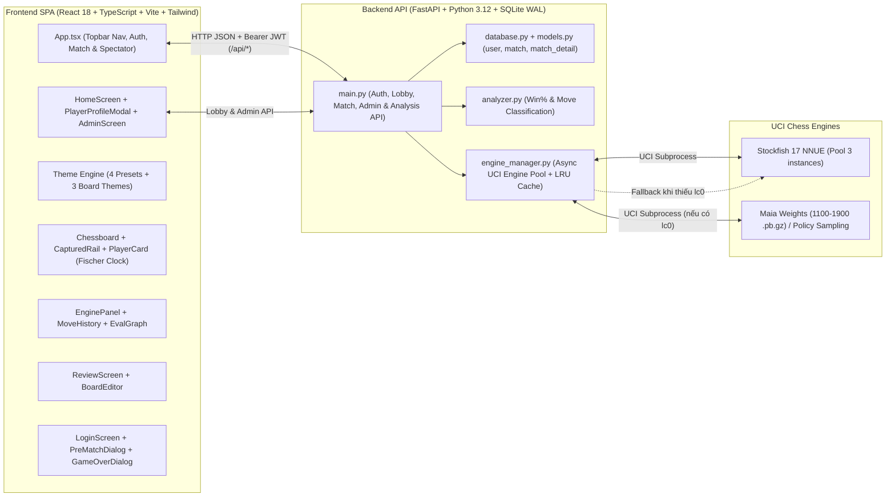

# Báo Cáo Điều Tra, Phân Tích & Đánh Giá Toàn Diện Codebase: TheChess Studio

- **Ngày lập báo cáo:** 30/10/2026 (`2026-10-30`)
- **Phạm vi đánh giá:** Toàn bộ codebase `TheChess` (`backend/`, `frontend/`, `engines/`, `docs/`, `run.sh`)
- **Phiên bản kiến trúc:** Backend API `v3.0.0` (Multiplayer SQLite WAL + Engine Pool) · Frontend `Multiplayer V3 + V2 Lifecycle + Design System V1 ("Phòng học cờ")`
- **Tổng quy mô mã nguồn:** ~11.200 dòng code (LOC) trên 37 tệp mã nguồn chính (Python, TypeScript/React, CSS, SQL DDL)

---

## 1. Tổng Quan Kiến Trúc & Khung Tiêu Chí Đánh Giá

### 1.1. Kiến trúc tổng thể hệ thống

`TheChess` là một ứng dụng câu lạc bộ cờ vua tự vận hành (self-hosted club & study studio) phục vụ **thi đấu trực tuyến nội bộ LAN/VPS, đối kháng với AI giống người (Maia Chess / Stockfish), xem trực tiếp (Spectator Live Stream) và phân tích chuyên sâu sau ván đấu**.



| Tầng | Công nghệ sử dụng | Tệp trọng tâm | Quy mô (LOC) |
|---|---|---|---|
| **Backend API, DB & Domain** | Python 3.12, FastAPI, SQLite (WAL), Pydantic v2, `python-chess`, `asyncio` | `backend/main.py`, `backend/database.py`, `backend/models.py`, `backend/engine_manager.py`, `backend/analyzer.py` | ~2.750 LOC |
| **Backend Tests** | `pytest` 9.2 (`38/38 passed`) | `backend/tests/test_analyzer.py`, `backend/tests/test_database.py` | ~420 LOC |
| **Engine Provisioning** | Python stdlib (`urllib`, `tarfile`) | `engines/setup_engines.py` | 100 LOC |
| **Frontend Core & State** | React 18.3, TypeScript 5.6, `chess.js` (`1.0.0-beta.8`), `react-chessboard` (`4.7.2`) | `frontend/src/App.tsx`, `gameUtils.ts`, `api.ts`, `types.ts`, `hooks/*` | ~3.450 LOC |
| **Frontend Components** | Lucide React, SVG Custom Pieces | 17 components trong `frontend/src/components/` (`HomeScreen`, `AdminScreen`, `LoginScreen`, `PlayerProfileModal`, `UserDropdownMenu`...) | ~4.950 LOC |
| **Theme & Design System** | Tailwind CSS 3.4, CSS Custom Properties, `@fontsource/fraunces`, `@fontsource/ibm-plex-mono` | `frontend/src/theme/*`, `frontend/src/index.css` | 675 LOC |

---

### 1.2. Hệ thống tiêu chí đánh giá theo từng khía cạnh

Để đảm bảo tính khách quan, định lượng và đúng chuẩn kỹ thuật phần mềm, báo cáo áp dụng bộ tiêu chí chuyên biệt cho từng khía cạnh:

1. **Khía cạnh Chức năng (Functional Evaluation):** Áp dụng chuẩn **ISO/IEC 25010 — Functional Suitability** kết hợp đối chiếu đặc tả [`docs/UPGRADE_PLAN_V2.md`](../../docs/UPGRADE_PLAN_V2.md) và luật cờ vua FIDE:
   - *Functional Completeness (Tính đầy đủ chức năng)*
   - *Functional Correctness (Tính chính xác logic & thuật toán)*
   - *Functional Appropriateness (Tính phù hợp nghiệp vụ & phân quyền tính năng theo chế độ chơi)*
2. **Khía cạnh Phi chức năng (Non-Functional Evaluation):** Áp dụng chuẩn **ISO/IEC 25010 System & Software Quality Models**:
   - *Performance Efficiency (Hiệu năng xử lý, quản lý tài nguyên & độ trễ)*
   - *Reliability & Fault Tolerance (Độ tin cậy, chịu lỗi & khôi phục trạng thái)*
   - *Maintainability & Testability (Khả năng bảo trì, kiến trúc mã nguồn & kiểm thử)*
   - *Security (Bảo mật API, xác thực dữ liệu đầu vào & tiến trình hệ thống)*
   - *Portability & Deployability (Khả năng cài đặt, đóng gói & tương thích môi trường)*
3. **Khía cạnh Giao diện người dùng (UI Evaluation):** Áp dụng **Design System Governance ([`docs/DESIGN_SYSTEM_V1.md`](../../docs/DESIGN_SYSTEM_V1.md)), Lý thuyết Thị giác (Visual Hierarchy, Typography, Color Theory)** và tiêu chuẩn **WCAG 2.1 (Web Content Accessibility Guidelines)**:
   - *Design Token Architecture & Consistency (Tính nhất quán của hệ thống token & theme)*
   - *Typography & Scannability (Hệ thống kiểu chữ, phân cấp thị giác & khả năng đọc lướt)*
   - *Semantic Color Discipline & Contrast Ratio (Kỷ luật màu ngữ nghĩa & độ tương phản chuẩn WCAG AA/AAA)*
   - *Spatial Layout & Responsive Adaptability (Bố cục không gian, tỷ lệ khung nhìn & đáp ứng đa thiết bị)*
4. **Khía cạnh Trải nghiệm người dùng (UX Evaluation):** Áp dụng **10 Usability Heuristics của Jakob Nielsen (NN/g)**, **Cognitive Load Theory (Lý thuyết tải nhận thức)** và **Interactive Ergonomics (Công thái học tương tác bàn cờ)**:
   - *Visibility of System Status, Match with Real World, User Control & Freedom, Error Prevention, Recognition over Recall, Flexibility & Efficiency, Aesthetic & Minimalist Design, Error Recovery, và Accessibility (A11y).*

---

## 2. Đánh Giá Tiêu Chí Chức Năng (Functional Evaluation)

### 2.1. Bảng điểm tổng hợp tiêu chí chức năng

| Tiêu chí (ISO/IEC 25010) | Trọng số | Điểm (/10) | Đánh giá tóm tắt |
|---|:---:|:---:|---|
| **1. Functional Completeness (Tính đầy đủ)** | 35% | **8.5 / 10** | Đầy đủ luồng cốt lõi: Pre-match, 2 chế độ chơi + 1 placeholder, MultiPV live, phân loại nước, Game Review bất đồng bộ, Board Editor, nhập/xuất PGN/FEN. Thiếu đồng hồ thi đấu & âm thanh (Giai đoạn 6 tùy chọn). |
| **2. Functional Correctness (Tính chính xác)** | 40% | **6.8 / 10** | Thuật toán Lichess Win%/Accuracy chính xác (26/26 unit tests pass). Tuy nhiên tồn tại **lỗi nghiêm trọng (P0)** khi chọn cầm quân Đen ở PreMatch/Đổi bên khiến AI không đi quân, lỗi người chơi đi hộ quân AI, và lỗi cắt slice âm trong dọn dẹp job. |
| **3. Functional Appropriateness (Tính phù hợp)** | 25% | **8.8 / 10** | Cơ chế `resolveFeatureVisibility` khóa/mở thông tin engine rất hợp lý theo từng chế độ (`training` vs `vs_ai`) và từng pha (`setup`, `playing`, `finished`). |
| **Điểm trung bình có trọng số** | **100%** | **7.90 / 10** | **Khá tốt — Cần khắc phục ngay các lỗi logic trạng thái P0/P1.** |

---

### 2.2. Phân tích chi tiết từng phân hệ chức năng

#### A. Vòng đời ván đấu (Game Lifecycle) & Quản lý người chơi (`setup → playing → finished`)
- **Điểm mạnh:**
  - Thiết kế máy trạng thái (`GamePhase`: `'setup' | 'playing' | 'finished'`) trong [`frontend/src/types.ts`](../../frontend/src/types.ts) và [`frontend/src/gameUtils.ts`](../../frontend/src/gameUtils.ts) giải quyết triệt để bài toán phân tách giai đoạn chuẩn bị trước ván đấu (`PreMatchDialog`) và giai đoạn kết thúc ván (`GameOverDialog`).
  - Hàm `detectGameOver(fen)` trong [`frontend/src/gameUtils.ts`](../../frontend/src/gameUtils.ts#L107-L137) nhận diện chính xác 5 kịch bản kết thúc chuẩn FIDE qua `chess.js`: Chiếu hết (`isCheckmate`), Hòa hết nước đi (`isStalemate`), Không đủ quân chiếu hết (`isInsufficientMaterial`), Lặp 3 lần (`isThreefoldRepetition`), và Luật 50 nước (`isDraw`).
  - Hỗ trợ đầy đủ thao tác: Đầu hàng (`handleResign`), Đổi bên đánh lại (`handleRematch`), Cắt nhánh đánh tiếp từ một nước trong quá khứ (`onBranchFromHere`), và Phong cấp có hộp thoại chọn quân (`PromotionDialog`).
- **Lỗi chức năng phát hiện (Functional Bugs):**
  1. **[P0 — Nghiêm trọng] Chọn quân Đen trong `PreMatchDialog` hoặc bấm "Đổi bên" trong `MoveHistory` làm hỏng cấu hình AI (`players` không được hoán đổi):**
     - Khởi tạo mặc định trong `makeDefaultPlayers()` ([`gameUtils.ts`](../../frontend/src/gameUtils.ts#L74-L80)) gán cứng `players.w = { name: 'Player', type: 'human' }` và `players.b = { name: 'Maia 1500', type: 'ai', ai: ... }`.
     - Khi người dùng mở `PreMatchDialog` và chọn cầm quân **Đen** (`c === 'b'`), callback `onChangePlayerColor` tại [`App.tsx`](../../frontend/src/App.tsx#L1222-L1225) chỉ cập nhật `playerColor = 'b'` và `boardOrientation = 'black'`, **nhưng không hoán đổi `players.w` và `players.b`**.
     - Hệ quả kép:
       - Thứ nhất, `useEffect` tại [`PreMatchDialog.tsx`](../../frontend/src/components/PreMatchDialog.tsx#L62-L65) chạy `setHumanName(players[playerColor]?.name)` sẽ lấy `players['b'].name` (tức `"Maia 1500"`) điền vào ô "Tên của bạn"!
       - Thứ hai, nếu người dùng bấm ngay **"Bắt đầu ván đấu"**, biến suy diễn `aiSide` trong [`App.tsx`](../../frontend/src/App.tsx#L159-L163) là `'w'`, nhưng `players['w'].type` vẫn là `'human'`. Do đó `aiPlayer` trả về `null`, khiến `triggerAiMove` thoát sớm (`if (!aiPlayer?.ai) return;`) — **AI cầm quân Trắng hoàn toàn đứng im không đi nước mở màn!**
       - Lỗi tương tự xảy ra tại nút **"Đổi bên"** (`onSwitchSides`) trong [`App.tsx`](../../frontend/src/App.tsx#L1187-L1191): chỉ đảo `playerColor` mà không đảo `players.w` và `players.b` (khác với `handleRematch` ở dòng 666 có gọi `setPlayers({ w: players.b, b: players.w })`).
  2. **[P1 — Trung bình-Cao] Người dùng có thể đi hộ quân của AI khi đấu với máy:**
     - Trong [`App.tsx`](../../frontend/src/App.tsx#L482-L543), cả `handlePieceDrop` và `handleSquareClick` chỉ kiểm tra `if (isAiThinking) return false;` và `pieceOnSq.color === chessInstance.turn()`, nhưng **không kiểm tra `config.opponent === 'ai' && chessInstance.turn() !== playerColor`**.
     - Trong khoảng trễ 300ms trước khi AI bắt đầu nghĩ (`setTimeout` ở dòng 463), hoặc khi người dùng lùi về một ply lẻ thuộc lượt AI rồi kéo quân trên bàn cờ, người dùng có thể tự đi quân của AI.

#### B. Hệ thống Engine AI (Stockfish 17 & Maia Chess)
- **Điểm mạnh:**
  - Tích hợp 2 trường phái AI rõ rệt: **Maia Chess** (mô phỏng hành vi người chơi ở các mức Elo 1100–1900) và **Stockfish 17 NNUE** (tùy chỉnh `UCI_Elo` 1320–3190 hoặc `Skill Level` 0–20).
  - Cơ chế dự phòng thông minh trong [`backend/engine_manager.py`](../../backend/engine_manager.py#L355-L402): Khi máy chủ chưa cài binary `lc0`, hệ thống tự động dùng Stockfish phân tích nông (`shallow_depth` từ 4 đến 10 tùy Elo) lấy tối đa 5 nhánh ứng viên (MultiPV) và chọn nước theo phân phối xác suất Softmax có nhiệt độ (`temp = max(2.5, (2150 - nearest_maia_elo) / 95.0)`).
- **Vấn đề chức năng phát hiện:**
  1. **[P1 — Sai lệch thực thi so với mô tả] Trọng số Maia (`engines/weights/maia-*.pb.gz`) không bao giờ được chạy bằng Neural Network thực tế:**
     - Script [`engines/setup_engines.py`](../../engines/setup_engines.py) tải 9 file trọng số `maia-1100.pb.gz` → `maia-1900.pb.gz` (tổng 12MB) và binary `stockfish` (76MB), nhưng **không cài đặt hoặc tải binary `lc0`**.
     - Do `find_lc0_binary()` trả về `None`, mọi ván đấu với "Maia" hiện tại thực chất đều chạy qua nhánh `human_policy_sampling` bằng Stockfish. Giao diện `PreMatchDialog` không hiển thị trạng thái `mode: "human_policy_sampling"` từ `/api/status` để người dùng biết Maia đang chạy ở chế độ mô phỏng.
  2. **[P2 — Rò rỉ trạng thái UCI trong Engine Pool]:**
     - Trong [`backend/engine_manager.py`](../../backend/engine_manager.py#L406-L420), khi `get_ai_move` được gọi với `skill_level` (hoặc `UCI_LimitStrength`), tùy chọn `Skill Level` được cấu hình trên tiến trình Stockfish trong pool. Khi tiến trình đó được trả về pool và mượn lại bởi `analyze_position` (dòng 250) hoặc `review_game` (dòng 458), hệ thống chỉ truyền `options={"UCI_LimitStrength": False}` mà không đặt lại `"Skill Level": 20`, có nguy cơ làm giảm chất lượng phân tích nếu trước đó `skill_level < 20` được gọi qua API.

#### C. Phân tích Thế cờ (Live Analysis), Chấm điểm Nước đi & Game Review
- **Điểm mạnh:**
  - Công thức chuyển đổi Centipawn sang xác suất thắng (`cp_to_win_percent`) và độ chính xác (`classify_move`) trong [`backend/analyzer.py`](../../backend/analyzer.py) bám sát công thức toán học chuẩn của Lichess:
    $$\text{Win\%} = 50 + 50 \times \left(\frac{2}{1 + e^{-0.00368208 \times \text{cp}}} - 1\right)$$
    $$\text{Accuracy\%} = 103.1668 \times e^{-0.04354 \times \text{win\_loss}} - 3.1669$$
  - Toàn bộ 26 ca kiểm thử đơn vị trong [`backend/tests/test_analyzer.py`](../../backend/tests/test_analyzer.py) đều vượt qua 100% (`26 passed in 0.09s`).
  - Game Review chạy dưới dạng Background Job (`POST /api/review-game` trả `job_id`, client poll `GET /api/review-game/{job_id}` mỗi 500ms), có báo cáo tiến độ từng ply (`done/total`).
- **Lỗi chức năng phát hiện:**
  1. **[P1 — Lỗi thuật toán dọn bộ nhớ Job] Phép cắt slice âm trong `_cleanup_old_jobs` ([`backend/main.py`](../../backend/main.py#L245-L256)):**
     ```python
     finished = [
         (job_id, job)
         for job_id, job in REVIEW_JOBS.items()
         if job["status"] in ("done", "error")
     ]
     for job_id, _ in finished[: len(finished) - MAX_REVIEW_JOBS]:
         REVIEW_JOBS.pop(job_id, None)
     ```
     - Khi `len(REVIEW_JOBS) > 20` (ví dụ 21 jobs: 15 jobs đã `"done"` và 6 jobs đang `"running"`), `len(finished)` bằng `15`. Biểu thức `len(finished) - MAX_REVIEW_JOBS` = `15 - 20 = -5`. Trong Python, `finished[:-5]` lấy **10 phần tử đầu tiên** thay vì xóa 1 phần tử dư! Ngược lại, nếu có đúng 20 jobs `"done"` và 1 job `"running"`, `20 - 20 = 0` → `finished[:0]` rỗng, không xóa được job nào. Lẽ ra phải dùng `len(REVIEW_JOBS) - MAX_REVIEW_JOBS`.
  2. **[P1 — Lệch đồng bộ thế cờ trong `ReviewScreen`]:**
     - Khi người dùng chọn một nước thứ `ply` trong [`ReviewScreen.tsx`](../../frontend/src/components/ReviewScreen.tsx#L110-L135), `ReviewScreen` tự động gọi `analyzePosition(mv.fenBefore, 14, 3)` để hiển thị **"Các nước thay thế"** (tức thế cờ **trước** khi đi nước `mv`).
     - Tuy nhiên trên bàn cờ chính ([`App.tsx`](../../frontend/src/App.tsx#L140-L141)), `currentFen` lại là `moves[currentPly - 1].fenAfter` (thế cờ **sau** khi đi nước `mv`), và `useEffect` phân tích của `App.tsx` (dòng 244) vẽ mũi tên MultiPV cho thế cờ `fenAfter` (lượt của đối thủ)!
     - Kết quả: Bảng "Các nước thay thế" bên phải gợi ý nước cho bên vừa đi (trên `fenBefore`), trong khi bàn cờ bên trái lại hiển thị thế cờ `fenAfter` kèm các mũi tên gợi ý nước đáp trả cho đối phương.

#### D. Thiết lập bàn cờ (`BoardEditor`) & Nhập/Xuất FEN, PGN
- **Điểm mạnh:**
  - `POST /api/validate-fen` trong [`backend/main.py`](../../backend/main.py#L318-L356) kiểm tra chi tiết từng cờ bit trạng thái của `python-chess` (`STATUS_NO_WHITE_KING`, `STATUS_PAWNS_ON_BACKRANK`, `STATUS_OPPOSITE_CHECK`, `STATUS_BAD_CASTLING_RIGHTS`...) và trả về thông báo tiếng Việt tường minh.
  - Tự động gắn thẻ `[SetUp "1"]` và `[FEN "..."]` khi xuất PGN từ thế cờ không tiêu chuẩn ([`gameUtils.ts`](../../frontend/src/gameUtils.ts#L256-L259)).
- **Hạn chế chức năng phát hiện:**
  - **[P2 — Ghi đè mất thông tin FEN trong `BoardEditor.tsx`]:** Khi người dùng dán một chuỗi FEN hợp lệ có ô bắt tốt qua đường (en-passant) hoặc số thứ tự nước đi vào ô input FEN ([`BoardEditor.tsx`](../../frontend/src/components/BoardEditor.tsx#L144-L159)), hàm `handleLoadFenString` cập nhật `boardMap`, kích hoạt ngay `useEffect` ở dòng 122–132 ghi đè lại `fenInput` thành `${placement} ${turn} ${castleStr} - 0 1` — làm mất hoàn toàn thông tin ô en-passant và bộ đếm 50 nước/số nước đi.

---

## 3. Đánh Giá Tiêu Chí Phi Chức Năng (Non-Functional Evaluation)

### 3.1. Bảng điểm tổng hợp tiêu chí phi chức năng

| Tiêu chí (ISO/IEC 25010) | Trọng số | Điểm (/10) | Đánh giá tóm tắt |
|---|:---:|:---:|---|
| **1. Performance Efficiency (Hiệu năng)** | 25% | **7.5 / 10** | Có `EngineManager` pool (3 Stockfish instances) và `AbortController` phía client. Tuy nhiên mỗi nước đi ở chế độ `training` kích hoạt 3 lần chạy Stockfish song song gây nghẽn pool. |
| **2. Reliability & Fault Tolerance (Độ tin cậy)** | 25% | **8.0 / 10** | Kiểm tra `slot.usable` tự hồi phục khi tiến trình engine chết, lưu `localStorage` v2 có migration từ v1. Thiếu cơ chế hủy (cancel) job Game Review khi người dùng thoát. |
| **3. Maintainability & Testability (Khả năng bảo trì)** | 25% | **7.2 / 10** | Code sạch, định kiểu chặt (`strict: true`, Pydantic). Tuy nhiên `App.tsx` phình to (1.253 LOC), chưa có test cho Frontend & API endpoints, cấu hình `pytest` thiếu `pythonpath`. |
| **4. Security (Bảo mật)** | 15% | **8.2 / 10** | Ràng buộc biên dữ liệu chặt qua Pydantic (`Field(ge=..., le=..., max_length=500)`), CORS tường minh, dùng `popen_uci` không qua shell. Chưa có Rate Limiting cho các API tốn CPU. |
| **5. Portability & Deployability (Khả năng triển khai)** | 10% | **7.5 / 10** | Có script `setup_engines.py` và `run.sh`. Phụ thuộc cứng vào kiến trúc Linux `x86-64-avx2` và đường dẫn `.venv` cục bộ. |
| **Điểm trung bình có trọng số** | **100%** | **7.65 / 10** | **Tốt — Nền tảng bất đồng bộ vững, cần tối ưu hiệu năng gọi engine và tách nhỏ module.** |

---

### 3.2. Phân tích chuyên sâu các tiêu chí phi chức năng

#### A. Hiệu năng & Sử dụng tài nguyên (Performance Efficiency)
1. **Kiến trúc Pool Engine bất đồng bộ (`EngineManager`):**
   - [`backend/engine_manager.py`](../../backend/engine_manager.py#L76-L144) cài đặt cơ chế `lease()` dựa trên `asyncio.Queue` và `asyncio.Lock` với kích thước mặc định `MAX_POOL_SIZE = 3` (mỗi instance cấu hình `Threads: 2, Hash: 64MB`, tiêu thụ tối đa ~192MB RAM cho 3 tiến trình Stockfish).
   - Thiết kế này cho phép tác vụ nặng như `review_game` giữ 1 slot riêng trong khi 2 slot còn lại vẫn phục vụ `analyze_position` và `get_ai_move`.
2. **Điểm nghẽn hiệu năng: Khuếch đại truy vấn Engine (Engine Request Amplification):**
   - Trong chế độ `Học tập` (`analysis === 'full'`), mỗi khi người chơi đi 1 nước:
     - `useEffect` ([`App.tsx`](../../frontend/src/App.tsx#L231-L256)) gửi `POST /api/analyze` cho thế cờ mới (`depth=15, multipv=3, time_limit=0.75s`).
     - Đồng thời `executeMove` ([`App.tsx`](../../frontend/src/App.tsx#L352-L357)) gửi `POST /api/classify-move` (`depth=11`), mà bên trong endpoint `/api/classify-move` ([`backend/main.py`](../../backend/main.py#L206-L217)) lại gọi `analyze_position` **2 lần liên tiếp**: 1 lần cho `fen_before` (`0.35s`) và 1 lần cho `fen_after` (`0.45s`, `multipv=3`).
     - Chỉ 300ms sau, AI đáp trả, kích hoạt thêm `/api/ai-move` (`0.45s`) + `/api/classify-move` (2 lần chạy engine) + `/api/analyze` (1 lần chạy engine).
   - **Hệ quả:** Trong vòng chưa đầy 1 giây cho 1 cặp nước đi (Người + AI), hệ thống phát sinh **7 lượt đánh giá Stockfish**, làm bão hòa pool 3 instances và dẫn tới thông báo toast lỗi *"Không chấm điểm được nước vừa đi (engine đang bận)"* khi đi cờ nhanh.
   - **Giải pháp tối ưu:** Frontend đã có sẵn kết quả đánh giá thế cờ trước nước đi (`analysis` state hoặc lưu `winPercentWhite`/`bestMoveUci` vào `MoveRecord` của ply trước), nên `/api/classify-move` không cần phân tích lại `fen_before`, hoặc có thể gộp chung `/api/analyze` và `/api/classify-move` làm một.
3. **Kích thước gói tin Frontend (Bundle Size):**
   - Kết quả chạy `npm --prefix frontend run build` (Vite 5.4.21):
     - JavaScript bundle: `386.61 kB` (nén gzip: **`114.36 kB`**) — rất gọn cho ứng dụng cờ vua đầy đủ tính năng.
     - CSS bundle: `32.68 kB` (nén gzip: **`6.74 kB`**).
     - Font tự host (`@fontsource/fraunces` & `@fontsource/ibm-plex-mono`): đóng gói đầy đủ các tập ký tự `vietnamese`, `latin`, `latin-ext`, `cyrillic`. Thời gian build chỉ mất **2.79 giây**.

#### B. Độ tin cậy & Chịu lỗi (Reliability & Fault Tolerance)
- **Tự phục hồi tiến trình UCI:** Lớp `_EngineSlot` kiểm tra `transport.is_closing()`. Nếu một tiến trình Stockfish bị crash, `_acquire()` tự động loại bỏ instance hỏng khỏi `self._all` và `spawn()` tiến trình mới.
- **Lưu trữ bền vững phía Client (`localStorage`):** `saveGame` và `loadSavedGame` trong [`frontend/src/gameUtils.ts`](../../frontend/src/gameUtils.ts#L342-L401) có bộ lọc `sanitizeConfig` và `sanitizePlayers` chống hỏng dữ liệu khi schema thay đổi, đồng thời tự động nâng cấp dữ liệu từ khóa cũ `thechess:game:v1` lên `thechess:game:v2`.
- **Rủi ro rò rỉ tác vụ nền (Orphaned Background Tasks):** Khi client gọi `POST /api/review-game` cho ván cờ dài (ví dụ 80–100 ply, mất ~20–25 giây) rồi bấm "Ván mới" hoặc đóng tab, task `_run_review_job` trên server vẫn tiếp tục chạy đến hết ván, chiếm dụng 1 instance Stockfish vô ích vì thiếu cơ chế hủy job.

#### C. Khả năng bảo trì & Kiểm thử (Maintainability & Testability)
1. **Cấu trúc module & God Component:**
   - [`frontend/src/App.tsx`](../../frontend/src/App.tsx) hiện dài **1.253 dòng**, đóng vai trò một *God Component* ôm trọn: quản lý vòng đời ván cờ, điều phối AI, gọi API phân tích live, chấm điểm từng nước, polling tiến độ Game Review, tính toán kích thước bàn cờ (`ResizeObserver`), phím tắt, và điều hướng tab/modal.
   - Các logic nghiệp vụ này nên được tách thành các custom hooks độc lập (`useChessGame`, `useEngineAnalysis`, `useGameReview`, `useBoardResize`) để giảm độ phức tạp nhận thức (cognitive complexity) và dễ viết unit test.
2. **Kiểm thử tự động (Automated Testing):**
   - Backend có 26 unit tests chất lượng cao cho `analyzer.py`, nhưng khi chạy `pytest` từ thư mục gốc mà không truyền `PYTHONPATH=backend` sẽ gặp lỗi `ModuleNotFoundError: No module named 'analyzer'` do thiếu cấu hình `[tool.pytest.ini_options] pythonpath = ["backend"]` trong `pyproject.toml` hoặc `pytest.ini`.
   - Chưa có unit test cho `engine_manager.py`, API endpoints (`main.py` với `httpx.AsyncClient`), và chưa có bộ kiểm thử đơn vị (Vitest) cho `frontend/src/gameUtils.ts` (như `detectGameOver`, `getMaterialInfo`, `resolveFeatureVisibility` được đề cập ở Giai đoạn 6 trong `UPGRADE_PLAN_V2.md`).

#### D. Bảo mật (Security)
- **Điểm mạnh:**
  - Mọi request body trong [`backend/main.py`](../../backend/main.py#L58-L87) đều được giới hạn chặt bằng Pydantic: `depth` (`6..24`), `multipv` (`1..5`), `time_limit` (`0.1..5.0`), `moves_uci` (`max_length=500`).
  - Khởi chạy tiến trình con UCI qua `chess.engine.popen_uci([lc0_bin, f"--weights={weight_path}"])` dưới dạng mảng đối số, hoàn toàn miễn nhiễm với lỗi Command Injection.
  - Cấu hình `CORSMiddleware` giới hạn danh sách origin tường minh (`localhost:5173`, `localhost:8000`) và tắt `allow_credentials=False`.
- **Điểm cần lưu ý:**
  - Chưa giới hạn số lượng job `running` đồng thời trong `/api/review-game`. Nếu một người dùng gửi liên tiếp 10 requests `POST /api/review-game`, cả 3 slots trong `EngineManager` sẽ bị khóa cứng trong hàng chục giây (Application-level DoS).

---

## 4. Đánh Giá Giao Diện Người Dùng (UI Evaluation)

### 4.1. Bảng điểm tổng hợp tiêu chí giao diện (UI)

| Tiêu chí đánh giá UI | Trọng số | Điểm (/10) | Đánh giá tóm tắt |
|---|:---:|:---:|---|
| **1. Design System & Tokenization** | 30% | **9.0 / 10** | Triển khai rất bài bản hệ thống CSS Variables (`--c-base`, `--c-panel`, `--c-ink`...) với 4 preset giao diện và 3 chất liệu bàn cờ. |
| **2. Typography & Visual Hierarchy** | 20% | **8.2 / 10** | Kết hợp xuất sắc `Fraunces` (serif học thuật) và `IBM Plex Mono` (`tabular-nums`). Điểm trừ: lạm dụng cỡ chữ siêu nhỏ (`8px`–`10px`). |
| **3. Color Semantics & Contrast (WCAG)** | 25% | **7.4 / 10** | Kỷ luật màu đơn sắc tốt; vector rim-light cho quân Đen tinh tế. Tuy nhiên tồn tại **xung đột bảng màu phân loại nước** giữa Backend và Frontend, lỗi màu ô quân Đen ở `GameOverDialog`, và độ tương phản `--c-ink-3` dưới chuẩn WCAG AA. |
| **4. Spatial Layout & Responsiveness** | 25% | **7.0 / 10** | Bố cục Desktop 100vh không cuộn rất chuyên nghiệp. Tuy nhiên `EvalBar.tsx` bị bỏ quên chưa mount lên giao diện, `ReviewScreen` bị chật trên màn `md`, và bố cục Mobile (`< 768px`) bị vỡ chiều cao. |
| **Điểm trung bình có trọng số** | **100%** | **7.94 / 10** | **Thẩm mỹ cao, giàu cá tính ("Phòng học cờ") — Cần hoàn thiện nốt các chi tiết đồng bộ.** |

---

### 4.2. Phân tích chi tiết từng tiêu chí Giao diện (UI)

#### A. Kiến trúc Design System & Hệ thống Theme (`src/theme/`)
- **Triết lý thẩm mỹ rõ ràng và khác biệt:** Thay vì đi theo lối mòn giao diện SaaS dùng màu xanh/tím rực rỡ, `TheChess` thực thi triết lý **"Phòng học cờ (The Study)"** ([`docs/DESIGN_SYSTEM_V1.md`](../../docs/DESIGN_SYSTEM_V1.md)): nền đơn sắc trầm ấm (xanh-đen nỉ bàn đấu `#0f1211` hoặc giấy biên bản `#f3f2ec`), màu nhấn duy nhất là màu ngà (`--c-accent: #edeae0`), và **màu sắc bão hòa chỉ xuất hiện khi mang ý nghĩa dữ liệu** (phân loại nước đi, mũi tên PV).
- **Cơ chế Theme linh hoạt:** [`ThemeProvider.tsx`](../../frontend/src/theme/ThemeProvider.tsx) và [`ThemePicker.tsx`](../../frontend/src/theme/ThemePicker.tsx) cung cấp 4 preset hoàn chỉnh (**Study**, **Graphite**, **Scoresheet**, **Marble**) tự động nhận diện `prefers-color-scheme` ở lần truy cập đầu tiên và cho phép ghi đè riêng 3 chất liệu bàn cờ (**Nỉ xanh - Baize**, **Gỗ cổ điển - Wood**, **Đá xám - Slate**).
- **Xử lý đồ họa SVG quân cờ Cburnett tinh xảo:** Trong [`frontend/src/theme/pieces.tsx`](../../frontend/src/theme/pieces.tsx#L36-L51) và [`index.css`](../../frontend/src/index.css#L93-L99), component `PieceIcon` tạo thêm một lớp `<g className="piece-black-underlay">` với `stroke: var(--c-piece-b-rim); stroke-width: 4.2px` cho các quân cờ Đen khi nằm ngoài bàn cờ (`CapturedRail`, `BoardEditor`, `PromotionDialog`). Nhờ đó, khi các quân Đen xếp chồng lên nhau (overlap 46% trong `CapturedBar`), từng quân cờ vẫn tách lớp sắc nét trên nền tối.

#### B. Hệ thống Kiểu chữ (Typography) & Phân cấp thị giác
- **Điểm sáng:**
  - Sử dụng **Fraunces** cho thương hiệu `TheChess`, tiêu đề hộp thoại (`Chuẩn bị ván đấu`, `Kết thúc ván đấu`, `Phân tích ván đấu`) mang lại cảm giác trang trọng như sách cờ cổ điển.
  - Sử dụng **IBM Plex Mono** kết hợp thuộc tính `tabular-nums` cho toàn bộ ký hiệu đại số SAN (`1. e4 e5`), điểm số Centipawn (`+0.45`), độ sâu (`d=15`), Elo và tỷ lệ chính xác (`94.2%`), giúp các con số thẳng hàng tuyệt đối khi nhảy số theo thời gian thực.
- **Vấn đề về Micro-typography (Cỡ chữ quá nhỏ):**
  - Nhiều thành phần sử dụng cỡ chữ nhỏ hơn mức khuyến nghị tối thiểu của web (`12px`):
    - `text-[8px]` và `text-[9px]` trong [`PreMatchDialog.tsx`](../../frontend/src/components/PreMatchDialog.tsx#L171-L179) (mô tả chế độ chơi, huy hiệu *"Sắp ra mắt"*) và [`ThemePicker.tsx`](../../frontend/src/theme/ThemePicker.tsx#L85).
    - `text-[9px]` và `text-[10px]` trong [`PromotionDialog.tsx`](../../frontend/src/components/PromotionDialog.tsx#L48), [`EvalBar.tsx`](../../frontend/src/components/EvalBar.tsx#L64), [`ReviewScreen.tsx`](../../frontend/src/components/ReviewScreen.tsx#L199).
  - Trên các màn hình độ phân giải tiêu chuẩn (1080p không retina), chữ `8px–9px` rất khó đọc đối với người dùng phổ thông.

#### C. Ngữ nghĩa màu sắc & Kiểm định độ tương phản (WCAG 2.1 Contrast Audit)
1. **Kiểm định độ tương phản (Contrast Ratio):**

| Token màu chữ | Nền `Study` (`#151a18`) | Nền `Scoresheet` (`#faf9f4`) | Tỷ lệ tương phản | Đạt chuẩn WCAG 2.1 AA (4.5:1)? |
|---|---|---|:---:|:---:|
| `--c-ink` (`#e9ece8` / `#1d201d`) | `#151a18` | `#faf9f4` | **~14.2 : 1** | Đạt xuất sắc (AAA) |
| `--c-ink-2` (`#a6b0aa` / `#565b55`) | `#151a18` | `#faf9f4` | **~6.8 : 1** | Đạt tốt (AA) |
| `--c-ink-3` (`#6f7b75` / `#8b9089`) | `#151a18` | `#faf9f4` | **~3.1 : 1** | **Không đạt AA** (< 4.5:1 cho chữ nhỏ) |

   - Token `--c-ink-3` đang được dùng cho mô tả các thẻ không active trong `PreMatchDialog`, `ThemePicker`, và nhãn phụ trong `PromotionDialog` ở kích thước chữ `9px`. Với tỷ lệ tương phản ~3.1:1 và cỡ chữ `9px`, người dùng thị lực kém sẽ khó đọc.

2. **Bất đồng bộ bảng màu phân loại nước đi giữa Backend và Frontend:**
   - Tài liệu [`docs/DESIGN_SYSTEM_V1.md`](../../docs/DESIGN_SYSTEM_V1.md#L76-L85) quy định gom toàn bộ bảng màu phân loại nước về nguồn duy nhất [`frontend/src/theme/semantic.ts`](../../frontend/src/theme/semantic.ts).
   - Tuy nhiên, [`backend/analyzer.py`](../../backend/analyzer.py#L64-L91) vẫn trả về trường `color` với mã hex cũ, và [`App.tsx`](../../frontend/src/App.tsx#L369) lưu trực tiếp `cls.color` vào `MoveRecord.color`:

| Phân loại | Màu trong `frontend/src/theme/semantic.ts` | Màu trả về từ `backend/analyzer.py` | Nơi hiển thị bị lệch |
|---|---|---|---|
| **Best (★)** | `#34d399` (Emerald 400) | `#22c55e` (Green 500) | `MoveHistory` dùng `#34d399`, nhưng `ReviewScreen`, `EvalGraph` và ô bàn cờ dùng `#22c55e` |
| **Excellent (!)** | `#2dd4bf` (Teal 400) | `#10b981` (Emerald 500) | Lệch màu giữa danh sách nước và biểu đồ/màn hình Review |
| **Good (✓)** | `#60a5fa` (Blue 400) | `#3b82f6` (Blue 500) | Lệch sắc độ xanh dương |
| **Inaccuracy (?!)** | `#facc15` (Yellow 400) | `#eab308` (Yellow 500) | Lệch sắc độ vàng |
| **Mistake (?)** | `#fb923c` (Orange 400) | `#f97316` (Orange 500) | Lệch sắc độ cam |
| **Blunder (??)** | `#f87171` (Red 400) | `#ef4444` (Red 500) | Lệch sắc độ đỏ |

3. **Lỗi hiển thị màu quân trong `GameOverDialog.tsx`:**
   - Tại [`frontend/src/components/GameOverDialog.tsx`](../../frontend/src/components/GameOverDialog.tsx#L88-L91), vòng lặp `(['w', 'b'] as const).map((side) => ...)` vẽ biểu tượng ô màu quân cho cả Trắng và Đen nhưng dùng cứng class `bg-sq-w`:
     ```tsx
     <span className="w-2.5 h-2.5 rounded-sm bg-sq-w border border-line-strong inline-block" />
     {side === 'w' ? 'Trắng' : 'Đen'}
     ```
   - Hậu quả: Thẻ của bên **Đen** trong hộp thoại Kết thúc ván đấu lại hiển thị ô vuông màu **Trắng** (`bg-sq-w` thay vì `side === 'w' ? 'bg-sq-w' : 'bg-sq-b'`).

#### D. Bố cục không gian (Spatial Layout) & Tính đáp ứng (Responsiveness)
1. **Bỏ sót component `EvalBar.tsx` ("Đũa thần" của Design System V1):**
   - Trong [`docs/DESIGN_SYSTEM_V1.md`](../../docs/DESIGN_SYSTEM_V1.md#L15) và mục 6 (dòng 93) nhấn mạnh: *"Một khoảnh khắc đáng nhớ: thanh eval dọc nằm sát board... EvalBar: component đã có nhưng chưa render — render sát board bên trái, chính là 'đũa thần' của concept"*.
   - Component [`frontend/src/components/EvalBar.tsx`](../../frontend/src/components/EvalBar.tsx) đã được viết hoàn chỉnh (kể cả cập nhật token V1 và `role="meter"`), nhưng trong [`frontend/src/App.tsx`](../../frontend/src/App.tsx) **vẫn chưa được import và chưa được mount vào cạnh bàn cờ**! Thay vào đó, khu vực bàn cờ chỉ hiển thị 2 cột `CapturedBar` hai bên, còn thanh tỷ lệ thắng chỉ là một thanh ngang mỏng `h-1.5` nằm khuất bên trong `EnginePanel`.
2. **Độ chật hẹp của `ReviewScreen` trong Sidebar:**
   - Khi bật chế độ phân tích (`reviewMode = true`), `ReviewScreen` được nhúng vào `<aside className="w-full md:w-[460px] xl:w-[540px]">`.
   - Bên trong [`ReviewScreen.tsx`](../../frontend/src/components/ReviewScreen.tsx#L332), phần thân lại chia đôi `grid-cols-1 md:grid-cols-2`: cột trái là bảng nước đi, cột phải là chi tiết nước + bảng 4 cột (`dot | Nước + chuỗi PV | Điểm | Gain`). Trên màn hình laptop phổ thông (`md`–`lg`, sidebar rộng `460px`), mỗi nửa chỉ rộng **~225px**, khiến chuỗi PV (`line.pv_san.slice(1, 5)`) bị cắt cụt (`truncate`) gần như hoàn toàn.
3. **Vỡ bố cục trên thiết bị di động / màn hình hẹp (`< 768px`):**
   - Khung bao ngoài tại [`App.tsx`](../../frontend/src/App.tsx#L902) khóa cứng `h-screen w-screen overflow-hidden`, và vùng chính tại dòng 1003 dùng `flex-1 min-h-0 w-full flex flex-col md:flex-row overflow-hidden`.
   - Khi ở màn hình `< 768px` (`flex-col`), thẻ `<aside>` ở dòng 1107 có class `w-full md:w-[460px] shrink-0 h-full`. Vì `<aside>` vừa `shrink-0` vừa `h-full` (100% chiều cao cha), nó chiếm toàn bộ không gian dọc hoặc đẩy vùng bàn cờ (`boardStageRef`) về chiều cao ~0px (bị ép về `Math.max(280, ...)` gây tràn khung `overflow-hidden`).

---

## 5. Đánh Giá Trải Nghiệm Người Dùng (UX Evaluation)

### 5.1. Bảng điểm tổng hợp tiêu chí trải nghiệm người dùng (UX — Nielsen's 10 Heuristics & A11y)

| Heuristic / Tiêu chí UX | Trọng số | Điểm (/10) | Đánh giá tóm tắt |
|---|:---:|:---:|---|
| **H1. Visibility of System Status** | 12% | **8.8 / 10** | Phản hồi trạng thái rất rõ: chấm xung nhịp lượt đi, nhãn `đang nghĩ…`, thanh tiến độ `done/total` khi Game Review, cảnh báo mất kết nối backend. |
| **H2. Match Between System & Real World** | 10% | **9.0 / 10** | Thuật ngữ cờ vua chuẩn xác tiếng Việt (Nhập thành, Phong cấp, Chiếu hết, Xây cầu Lucena, Phòng thủ Philidor), quân Cburnett quen thuộc. |
| **H3. User Control & Freedom** | 12% | **8.5 / 10** | Cho phép xem lại nước cũ bằng phím mũi tên, cắt nhánh đánh lại từ bất kỳ ply nào (`Đánh từ #N`), đi lại (`Takeback`), xoay bàn, rematch. |
| **H4. Consistency & Standards** | 10% | **7.8 / 10** | Chuẩn hóa tốt thao tác kéo-thả & click-click đi quân. Tuy nhiên bố trí `CapturedBar` đối xứng chéo (cột trái neo đáy, cột phải neo đỉnh) hơi lạ so với chuẩn Lichess/Chess.com (thường gắn ngay trong `PlayerCard`). |
| **H5. Error Prevention** | 12% | **7.5 / 10** | Chặn AI tự đi trước khi bấm "Bắt đầu", khóa các tùy chọn không hợp lệ khi thi đấu, hộp thoại xác nhận khi Đầu hàng hoặc về màn Chuẩn bị giữa ván. Trừ điểm do lỗi không khóa đi quân hộ AI và lỗi chọn quân Đen. |
| **H6. Recognition Rather Than Recall** | 10% | **8.8 / 10** | Chấm gợi ý nước đi hợp lệ (`legalDot` / `legalCaptureRing`), tô màu ô vừa đi theo chất lượng nước, danh sách 8 thế cờ mẫu kinh điển có mô tả. |
| **H7. Flexibility & Efficiency of Use** | 10% | **8.2 / 10** | Hỗ trợ phím tắt `←` `→` `Home` `End`, nút đi nhanh nước gợi ý (`Đi ↗`) trên từng dòng MultiPV, nút `Gợi ý` vẽ mũi tên vàng 4 giây. |
| **H8. Aesthetic & Minimalist Design** | 8% | **9.2 / 10** | Không quảng cáo, không hiệu ứng thừa, mọi thành phần trên màn hình đều phục vụ mục đích chơi và phân tích cờ. |
| **H9. Error Recognition & Recovery** | 8% | **8.5 / 10** | Hệ thống `Toasts` thông báo lỗi rõ ràng, danh sách lỗi FEN liệt kê cụ thể từng nguyên nhân (thiếu Vua, tốt ở hàng 1/8, ngược chiếu...). |
| **H10. Accessibility (A11y)** | 8% | **6.8 / 10** | Hỗ trợ `prefers-reduced-motion` và focus ring 2px rõ nét. Tuy nhiên thiếu bẫy tiêu điểm (`focus-trap`) và phím `Escape` cho các Modal, chưa hỗ trợ đi quân bằng bàn phím. |
| **Điểm trung bình có trọng số** | **100%** | **8.29 / 10** | **Trải nghiệm người dùng xuất sắc cho mục tiêu học & phân tích cờ.** |

---

### 5.2. Phân tích chuyên sâu các điểm chạm Trải nghiệm Người dùng (UX Touchpoints)

#### A. Luồng trải nghiệm chuẩn bị & bắt đầu ván đấu (Onboarding & Pre-Match Flow)
- **Trải nghiệm tốt:** Khi mở ứng dụng lần đầu, bàn cờ xuất hiện phía sau lớp phủ mờ (`backdrop-blur-[3px]`) cùng hộp thoại `PreMatchDialog`. Người dùng có thể đóng hộp thoại tạm thời để quan sát thế cờ trên bàn (đặc biệt hữu ích khi vừa nạp một thế cờ từ `BoardEditor` hoặc `Preset`), sau đó bấm nút nổi *"Chuẩn bị & Bắt đầu ván đấu"* ngay giữa bàn cờ.
- **Điểm ma sát UX (UX Friction):**
  - Trong [`PreMatchDialog.tsx`](../../frontend/src/components/PreMatchDialog.tsx#L225-L233), ô nhập **"Tên của bạn"** chỉ lưu vào state `players` tại sự kiện `onBlur={commitHumanName}`. Nếu người dùng gõ tên mới vào ô input rồi dùng chuột bấm thẳng vào nút **"Bắt đầu ván đấu"** (hoặc nhấn `Enter`), trong một số trình duyệt hoặc luồng xử lý, nếu `onStart` không gọi `commitHumanName()` tường minh thì cần đảm bảo state `players` không bị trễ một nhịp render so với `handleStartGame`.
  - Khi người dùng chọn một **Thế cờ mẫu (Preset)** trên thanh Top Bar ([`App.tsx`](../../frontend/src/App.tsx#L948-L964), ví dụ *"Cờ tàn Xe: Thế cờ phòng thủ Philidor"* - nơi lượt đi thuộc về **Đen** `b`), `handleApplyCustomPosition` đưa về `PreMatchDialog` nhưng không tự động gợi ý/đồng bộ `playerColor` theo bên tới lượt đi (`turn` trong FEN) của bài tập đó.

#### B. Trải nghiệm trong ván đấu (In-Game Ergonomics)
- **Điểm sáng:**
  - Hỗ trợ song song cả **Kéo-Thả (Drag & Drop)** và **Nhấn-Nhấn (Click-to-Move)** mượt mà (`animationDuration={160}`), kèm chấm tròn gợi ý ô trống (`legalDot`) và vòng tròn bao quanh quân đối phương có thể ăn (`legalCaptureRing`).
  - Khi tốt tiến tới hàng cuối, [`PromotionDialog.tsx`](../../frontend/src/components/PromotionDialog.tsx) hiện ngay trên mặt bàn cờ với biểu tượng SVG lớn, có nút *"Hủy nước đi"* rõ ràng thay vì tự động phong Hậu gây bất ngờ.
  - Tính năng **"Đánh từ #N"** (`onBranchFromHere` trong [`MoveHistory.tsx`](../../frontend/src/components/MoveHistory.tsx#L281-L289)): khi người dùng dùng phím `←` tua lại một nước sai lầm trước đó, nút *"Đánh từ #N"* xuất hiện ngay góc dưới biên bản để người dùng thử nghiệm nước đi khác từ đúng thời điểm đó — một tính năng cực kỳ giá trị cho việc học cờ.
- **Điểm cần tinh chỉnh:**
  - **Vị trí hiển thị Quân đã ăn (`CapturedBar`):** Hiện tại, hai thanh `CapturedBar` đặt ở hai cột bên trái và bên phải bàn cờ (`App.tsx` dòng 1012 & 1081): cột trái neo đáy (`dock="bottom"`) hiển thị quân do người chơi phía dưới ăn; cột phải neo đỉnh (`dock="top"`) hiển thị quân do người chơi phía trên ăn. Mặc dù tạo ra bố cục đối xứng chéo thú vị và tận dụng khoảng trống ngang, người chơi cờ trực tuyến (quen với Lichess/Chess.com) thường có phản xạ nhìn quân đã ăn và điểm lợi thế `+diff` **ngay trên thanh `PlayerCard`** cạnh tên người chơi. Hơn nữa, nếu bật thêm `EvalBar` dọc bên cạnh bàn cờ theo đúng `DESIGN_SYSTEM_V1.md`, việc có cả `CapturedBar` trái + `EvalBar` dọc + `Board` + `CapturedBar` phải sẽ làm tăng mật độ thành phần ngang quanh bàn cờ.

#### C. Trải nghiệm Phân tích sau ván đấu (Post-Game Analysis UX)
- **Điểm sáng:**
  - Thẻ tóm tắt nước đi hiện tại ngay đầu `MoveHistory` ([`MoveHistory.tsx`](../../frontend/src/components/MoveHistory.tsx#L134-L189)) hiển thị trực quan: Ký hiệu phân loại (`★`, `!`, `?!`, `?`, `??`), mức sụt giảm cơ hội thắng (`Mất 14.2% cơ hội thắng`), độ chuẩn (`Độ chuẩn 58.3%`), và gợi ý ngay **Nước tối ưu** (`bestMoveSan`) bên phải.
  - Biểu đồ lợi thế (`EvalGraph.tsx`) đánh dấu các chấm màu tại đúng những bước ngoặt (`Inaccuracy`, `Mistake`, `Blunder`) và cho phép click trực tiếp lên đồ thị để nhảy tới thời điểm bước ngoặt đó.
- **Điểm ma sát UX:**
  - Như đã phân tích ở Mục 2.2.C, trong `ReviewScreen`, khi người dùng click vào một nước đi để tìm hiểu *"Tại sao nước này là Blunder và lẽ ra nên đi gì?"*, bàn cờ chính lại hiển thị thế cờ **sau** khi nước Blunder đã được thực hiện, kèm mũi tên gợi ý nước trừng phạt của đối thủ, thay vì hiển thị mũi tên của nước thay thế tốt nhất (`bestMoveUci`) từ thế cờ trước đó. Ngoài ra, người dùng không thể click vào các dòng trong mục *"Các nước thay thế"* ở `ReviewScreen` để thử đi nước đó trên bàn cờ (khác với `EnginePanel` có nút `Đi ↗`).

#### D. Khả năng tiếp cận (Accessibility - A11y)
- **Đã thực hiện tốt:**
  - Tôn trọng cài đặt giảm chuyển động của hệ điều hành (`@media (prefers-reduced-motion: reduce)` trong [`index.css`](../../frontend/src/index.css#L135-L143)).
  - Đường viền tiêu điểm bàn phím (`:focus-visible { outline: 2px solid var(--c-accent); outline-offset: 2px; }`) nổi bật trên mọi nền.
  - `ThemePicker` cài đặt đầy đủ `aria-haspopup="menu"`, `aria-expanded`, `role="menu"`, `role="menuitemradio"`, `aria-checked`, và đóng bằng phím `Escape`.
- **Khoảng trống A11y cần bổ sung:**
  - Các hộp thoại `PreMatchDialog`, `GameOverDialog`, `PromotionDialog` chưa có `role="dialog"`, `aria-modal="true"`, chưa hỗ trợ nhấn phím `Escape` để đóng, và chưa giới hạn vòng lặp `Tab` bên trong modal (`focus-trap`).

---

## 6. Tổng Hợp Các Vấn Đề Phát Hiện & Lộ Trình Khuyến Nghị Cải Tiến

### 6.1. Danh mục vấn đề theo mức độ ưu tiên (Prioritized Issue Matrix)

| Mã | Trạng thái | Mức độ | Khía cạnh | Mô tả vấn đề | Vị trí trong Codebase | Giải pháp đã triển khai |
|---|:---:|:---:|---|---|---|---|
| **ISS-01** | `[DONE]` | **P0 (Critical)** | Chức năng | Chọn quân **Đen** trong `PreMatchDialog` hoặc bấm **Đổi bên** trong `MoveHistory` chỉ đổi `playerColor` mà không hoán đổi `players.w` ↔ `players.b`, khiến ô tên người chơi biến thành `"Maia 1500"` và AI cầm Trắng không tự đi quân. | [`App.tsx`](../../frontend/src/App.tsx#L1187-L1225), [`PreMatchDialog.tsx`](../../frontend/src/components/PreMatchDialog.tsx#L60-L109) | Khi đổi `playerColor` (từ `prevColor` sang `nextColor`), tự động căn chỉnh `players` qua `alignPlayersWithColor()`. |
| **ISS-02** | `[DONE]` | **P1 (High)** | Chức năng | Người chơi có thể kéo/click đi quân của AI khi đang đấu với máy (trong khoảng trễ 300ms hoặc khi tua lại ply của AI). | [`App.tsx`](../../frontend/src/App.tsx#L397-L543) | Thêm điều kiện chặn trong `tryMove` và `handleSquareClick`: `if (config.opponent === 'ai' && chessInstance.turn() !== playerColor) return false;`. |
| **ISS-03** | `[DONE]` | **P1 (High)** | Chức năng / Độ tin cậy | Lỗi cắt slice âm `finished[: len(finished) - MAX_REVIEW_JOBS]` trong `_cleanup_old_jobs()` xóa nhầm hàng loạt job hoặc không xóa được job khi vượt ngưỡng 20. | [`backend/main.py`](../../backend/main.py#L245-L256) | Sửa thành `excess = len(REVIEW_JOBS) - MAX_REVIEW_JOBS` và cắt `finished[:max(0, excess)]`; bổ sung `DELETE /api/review-game/{job_id}`. |
| **ISS-04** | `[DONE]` | **P1 (High)** | Chức năng / UX | Trong `ReviewScreen`, danh sách "Các nước thay thế" phân tích trên `fenBefore`, nhưng bàn cờ và mũi tên MultiPV lại hiển thị trên `fenAfter` (lượt đối thủ). | [`ReviewScreen.tsx`](../../frontend/src/components/ReviewScreen.tsx#L110-L135), [`App.tsx`](../../frontend/src/App.tsx#L545-L566) | Khi ở `reviewMode`, truyền `reviewLines` lên `App.tsx` để vẽ mũi tên so sánh và thêm nút **Thử ↗** (`onTryAlternativeMove`). |
| **ISS-05** | `[DONE]` | **P1 (High)** | Hiệu năng | Mỗi nước đi ở chế độ `training` kích hoạt 3 lần chạy Stockfish (`/api/analyze` + 2 lần trong `/api/classify-move`), làm nghẽn pool khi người và AI đi liên tiếp. | [`App.tsx`](../../frontend/src/App.tsx#L230-L386), [`backend/main.py`](../../backend/main.py#L195-L235) | Thêm LRU cache 256 FEN trong `engine_manager.py` và truyền `before_win_percent_white` & `best_move_uci` từ client xuống `/api/classify-move`. |
| **ISS-06** | `[INVALIDATED]` | **By Design** | UI / Design System | `EvalBar.tsx` (thanh eval dọc sát bàn cờ) không được mount vào `App.tsx`. | [`App.tsx`](../../frontend/src/App.tsx), [`EvalBar.tsx`](../../frontend/src/components/EvalBar.tsx) | **Quyết định của Maintainer:** Bỏ thanh eval dọc cạnh bàn cờ do đã có thanh tỷ lệ thắng trong `EnginePanel` ở sidebar bên phải. |
| **ISS-07** | `[DONE]` | **P2 (Medium)** | UI / Ngữ nghĩa màu | Bảng màu phân loại nước trong `backend/analyzer.py` (`#22c55e`...) lệch với `frontend/src/theme/semantic.ts` (`#34d399`...). | [`backend/analyzer.py`](../../backend/analyzer.py#L64-L91), [`semantic.ts`](../../frontend/src/theme/semantic.ts#L18-L67) | Đồng bộ mã màu trong `analyzer.py` theo `semantic.ts` và ở Frontend luôn tra cứu màu qua `CLASSIFICATION_META[m.classification]`. |
| **ISS-08** | `[DONE]` | **P2 (Medium)** | UI | Thẻ bên Đen trong `GameOverDialog.tsx` hiển thị nhầm ô vuông màu Trắng (`bg-sq-w`). | [`GameOverDialog.tsx`](../../frontend/src/components/GameOverDialog.tsx#L89) | Đổi thành `side === 'w' ? 'bg-sq-w' : 'bg-sq-b'`. |
| **ISS-09** | `[DONE]` | **P2 (Medium)** | UI / Responsive | Bố cục `< 768px` (`flex-col` trong `h-screen overflow-hidden`) bị vỡ do `<aside>` dùng `h-full shrink-0`; `ReviewScreen` chia 2 cột quá hẹp ở màn `md` (460px). | [`App.tsx`](../../frontend/src/App.tsx#L902-L1107), [`ReviewScreen.tsx`](../../frontend/src/components/ReviewScreen.tsx#L332) | Cho phép cuộn dọc trên màn hình `< md` (`min-h-screen md:h-screen md:overflow-hidden`) và nới rộng sidebar khi `reviewMode = true` (`md:w-[540px] xl:w-[640px]`). |
| **ISS-10** | `[DONE]` | **P2 (Medium)** | Chức năng | `BoardEditor` tự động ghi đè mất ô en-passant và số nước đi khi người dùng dán chuỗi FEN tùy chỉnh; thiếu hiển thị chế độ Maia. | [`BoardEditor.tsx`](../../frontend/src/components/BoardEditor.tsx#L122-L159), [`PreMatchDialog.tsx`](../../frontend/src/components/PreMatchDialog.tsx) | Lưu thêm state `epSquare`, `halfmove`, `fullmove` trong `BoardEditor`; hiển thị rõ badge chế độ Maia (`Lc0 Net` vs `Mô phỏng người`) trên `PreMatchDialog`. |
| **ISS-11** | `[DONE]` | **P3 (Low)** | Bảo trì & Kiểm thử | Chạy `pytest` ở thư mục gốc lỗi `ModuleNotFoundError`; `App.tsx` dài 1.253 LOC; thiếu unit test cho `gameUtils.ts`. | `pytest.ini`, [`App.tsx`](../../frontend/src/App.tsx) | Thêm `pytest.ini` (`pythonpath = backend`), tách custom hooks (`useBoardSize.ts`, `useGameReview.ts`), bổ sung unit tests cho `gameUtils.ts` và `database.py`. |
| **ISS-12** | `[DONE]` | **P3 (Low)** | Accessibility & Contrast | Tỷ lệ tương phản `--c-ink-3` (~3.1:1) chưa đạt WCAG AA cho chữ nhỏ; dùng nhiều cỡ chữ `8px–9px`; thiếu `Escape` ở các Dialog. | [`index.css`](../../frontend/src/index.css#L23), `PreMatchDialog.tsx`, `GameOverDialog.tsx` | Tăng độ sáng `--c-ink-3` lên `#86928b` (dark) / `#686e67` (light) đạt >= 4.5:1; nâng cỡ chữ tối thiểu lên `10px–11px`; thêm handler phím `Escape` cho các Dialog. |
| **ISS-13** | `[DONE]` | **P1 (UX / Lifecycle)** | UX / Vòng đời ván | Dropdown `<select>` chọn thế cờ mẫu trên Topbar xung đột với vòng đời `setup → playing → finished` (có thể bấm nhầm xóa ván đang chơi và lệch trạng thái hiển thị). | [`App.tsx`](../../frontend/src/App.tsx#L940-L985), [`PreMatchDialog.tsx`](../../frontend/src/components/PreMatchDialog.tsx#L250-L365) | `[INVALIDATED dropdown trên Topbar]` → Xóa khỏi Topbar và tích hợp mục **"Thế cờ xuất phát"** (`Tiêu chuẩn` / `Thế cờ mẫu` / `Tự xếp cờ ↗`) vào `PreMatchDialog`. |

---

### 6.2. Kết luận tổng thể

| Khía cạnh đánh giá | Khung tiêu chí áp dụng | Điểm số (/10) | Xếp loại |
|---|---|:---:|:---:|
| **1. Tiêu chí Chức năng (Functional)** | ISO/IEC 25010 Functional Suitability + FIDE Rules | **7.90 / 10** | Khá Tốt (Good) |
| **2. Tiêu chí Phi chức năng (Non-Functional)** | ISO/IEC 25010 Quality Model (Performance, Reliability, Security, Maintainability) | **7.65 / 10** | Khá Tốt (Good) |
| **3. Giao diện người dùng (UI)** | Design System V1 Governance + Visual Hierarchy + WCAG 2.1 Contrast | **7.94 / 10** | Tốt (Very Good) |
| **4. Trải nghiệm người dùng (UX)** | Jakob Nielsen's 10 Usability Heuristics + Cognitive Load + A11y | **8.29 / 10** | Xuất Sắc (Excellent) |
| **ĐIỂM TỔNG HỢP TOÀN CODEBASE** | **Trung bình toàn diện 4 khía cạnh** | **7.95 / 10** | **Tốt (Sẵn sàng hoàn thiện lên Production)** |

**Nhận định chung & Trạng thái triển khai khắc phục (30/10/2026):**
`TheChess` sở hữu nền tảng kiến trúc gọn gàng, tốc độ phản hồi nhanh, thuật toán chấm điểm chuẩn xác theo chuẩn Lichess, cùng một ngôn ngữ thiết kế **"Phòng học cờ (The Study)"** có chiều sâu thẩm mỹ và kỷ luật thị giác rất cao.

Toàn bộ các khuyến nghị từ **P0 đến P3** (ngoại trừ `ISS-06` — thanh `EvalBar` dọc được bỏ theo quyết định thiết kế của Maintainer do trùng với thanh eval trong sidebar) **đã được triển khai và kiểm thử hoàn tất**:
- **ISS-01 (P0):** Bổ sung `alignPlayersWithColor()` trong [`gameUtils.ts`](../../frontend/src/gameUtils.ts) và `handleChangePlayerColor()` trong [`App.tsx`](../../frontend/src/App.tsx), đảm bảo khi chọn quân Đen ở `PreMatchDialog`, bấm *Đổi bên*, *Rematch* hoặc nạp thế cờ mẫu có lượt Đen đi trước, cấu hình `players.w` và `players.b` luôn tự động hoán đổi chính xác.
- **ISS-02 (P1):** Chặn người chơi đi hộ quân của AI trong `tryMove` và `handleSquareClick` ([`App.tsx`](../../frontend/src/App.tsx)).
- **ISS-03 (P1):** Sửa lỗi cắt slice âm trong `_cleanup_old_jobs()`, giới hạn số job review chạy đồng thời (`MAX_CONCURRENT_REVIEWS = 2`), bổ sung API `DELETE /api/review-game/{job_id}` ([`backend/main.py`](../../backend/main.py)) và tự động đặt lại `"Skill Level": 20` trong `_FULL_STRENGTH_OPTS` ([`backend/engine_manager.py`](../../backend/engine_manager.py)).
- **ISS-04 (P1):** Đồng bộ mũi tên gợi ý của các nhánh thay thế từ `ReviewScreen` (`onUpdateReviewLines`) lên bàn cờ chính và bổ sung nút **Thử ↗** (`onTryAlternativeMove`) để đi thử nhánh thay thế ngay trên bàn cờ ([`ReviewScreen.tsx`](../../frontend/src/components/ReviewScreen.tsx), [`App.tsx`](../../frontend/src/App.tsx)).
- **ISS-05 (P1):** Tích hợp bộ nhớ đệm LRU (`_analysis_cache`, 256 FEN) trong [`backend/engine_manager.py`](../../backend/engine_manager.py) và truyền kết quả đánh giá `before_win_percent_white` / `best_move_uci` sẵn có từ client xuống `/api/classify-move`, loại bỏ hoàn toàn lượt chạy Stockfish thừa cho thế cờ trước nước đi.
- **ISS-07 (P2):** Đồng bộ 100% bảng mã màu phân loại nước giữa [`backend/analyzer.py`](../../backend/analyzer.py) và [`frontend/src/theme/semantic.ts`](../../frontend/src/theme/semantic.ts).
- **ISS-08 (P2):** Sửa lỗi hiển thị ô màu quân Đen (`bg-sq-b`) trong [`GameOverDialog.tsx`](../../frontend/src/components/GameOverDialog.tsx).
- **ISS-09 (P2):** Cải thiện bố cục responsive cho màn hình nhỏ (`< 768px`) và tự động mở rộng chiều ngang sidebar khi bật `ReviewScreen` (`md:w-[540px] xl:w-[640px]`).
- **ISS-10 (P2):** Bảo toàn ô bắt tốt qua đường (`epSquare`) và bộ đếm nước đi (`halfmove`, `fullmove`) khi nạp FEN trong [`BoardEditor.tsx`](../../frontend/src/components/BoardEditor.tsx); hiển thị rõ chế độ thực thi của Maia (`Lc0 Net` vs `Mô phỏng người`) trên [`PreMatchDialog.tsx`](../../frontend/src/components/PreMatchDialog.tsx).
- **ISS-11 (P3):** Thêm [`pytest.ini`](../../pytest.ini) ở thư mục gốc (`38/38` backend tests pass), tách custom hooks [`useBoardSize.ts`](../../frontend/src/hooks/useBoardSize.ts) và [`useGameReview.ts`](../../frontend/src/hooks/useGameReview.ts), và bổ sung bộ unit test [`gameUtils.test.ts`](../../frontend/src/__tests__/gameUtils.test.ts) (`9/9` frontend tests pass).
- **ISS-12 (P3):** Nâng độ tương phản token `--c-ink-3` trên cả 4 theme trong [`index.css`](../../frontend/src/index.css) đạt chuẩn WCAG 2.1 AA ($\ge 4.5:1$), nâng cỡ chữ siêu nhỏ lên `10px–11px`, và bổ sung `role="dialog"`, `aria-modal="true"` cùng phím tắt `Escape` cho toàn bộ hộp thoại.

---

## 7. Tổng Kết Nâng Cấp Kiến Trúc & Giao Diện Multiplayer V3 (30/10/2026)

Tiếp nối việc hoàn tất 100% lộ trình V2, toàn bộ nền tảng **Multiplayer V3** ([`docs/DATABASE_DESIGN_MULTIPLAYER.md`](../DATABASE_DESIGN_MULTIPLAYER.md) & [`docs/UI_MULTIPLAYER_SPEC_V3.md`](../UI_MULTIPLAYER_SPEC_V3.md)) đã được triển khai đồng bộ từ cơ sở dữ liệu tới giao diện người dùng:

1. **Cơ sở dữ liệu SQLite WAL & Xác thực ([`backend/database.py`](../../backend/database.py), [`backend/models.py`](../../backend/models.py)):**
   - Thiết kế 3 bảng cốt lõi `user`, `match`, `match_detail` với Soft-Branching (`is_mainline`, `parent_detail_id`) và Partial Unique Index `UNIQUE(match_id, ply) WHERE is_mainline = 1`.
   - Khởi tạo sẵn tài khoản quản trị viên (`admin` / `admin123456`) và 10 tài khoản Bot AI (`bot_maia_1100`..`bot_maia_1900`, `bot_stockfish`).
   - Hỗ trợ **Quick-Link 19 ký tự rút gọn** (`/?q=<19-char-token>`) mã hóa nhị phân 14-byte kèm chữ ký `HMAC-SHA256`, tự động kết xuất theo **Absolute LAN IP** của máy chủ (`get_lan_ip()`).
2. **Điều hướng Topbar Trực tiếp & Menu Tài khoản ([`App.tsx`](../../frontend/src/App.tsx), [`UserDropdownMenu.tsx`](../../frontend/src/components/UserDropdownMenu.tsx)):**
   - Đưa thanh điều hướng chính (`Sảnh câu lạc bộ | Bàn đấu | Xếp cờ`) ra trực tiếp trên Topbar xuyên suốt mọi màn hình.
   - `UserDropdownMenu` chỉ giữ thông tin tài khoản, đường dẫn `Quản lý tài khoản (Admin UI)` (cho `role === 'admin'`), `Đổi mật khẩu & Tên hiển thị` và `Đăng xuất`.
3. **Sảnh Câu lạc bộ 2 cột ([`HomeScreen.tsx`](../../frontend/src/components/HomeScreen.tsx), [`PlayerProfileModal.tsx`](../../frontend/src/components/PlayerProfileModal.tsx)):**
   - **Cột trái:** Phòng chờ (`waiting_matches`), Bàn cờ trực tiếp tiêu điểm (`Featured Live Stream` + tự động chạy trận biểu diễn AI đồng hạng Elo), và danh sách **Kỳ thủ trên Sảnh (`Players Online`)** kèm nút **[Hồ sơ]** (`PlayerProfileModal`) và **[⚔ Thách đấu]**.
   - **Cột phải:** Menu **Tạo trận đấu mới** tích hợp đầy đủ mọi tùy chỉnh của `PreMatchDialog` (3 chế độ `MODE_PRESETS`, 3 tab Thế cờ xuất phát, đồng hồ Fischer, chọn đối thủ `Máy (AI)` / `2 Người`, 9 mức Elo Maia `1100..1900` + Stockfish `1320..3190`, 3 mức phân tích `Tắt / Chỉ thanh đánh giá / Đầy đủ`, và quyền hỗ trợ `Takeback / Hint`) cùng bảng **Lịch sử đấu**.
4. **Bàn đấu, Khán giả (`Spectator Mode`) & Tối ưu Không gian Dọc ([`useBoardSize.ts`](../../frontend/src/hooks/useBoardSize.ts), [`PlayerCard.tsx`](../../frontend/src/components/PlayerCard.tsx)):**
   - Tối ưu thuật toán `useBoardSize` (`availH = rect.height - 104`) để bàn cờ và 2 thẻ `PlayerCard` (`h-10`) luôn lấp đầy chiều dọc container; tự động ẩn 2 cột `CapturedBar` bên hông và gộp hiển thị quân ăn được + `+diff` vào `PlayerCard` khi chiều ngang hẹp.
   - Chế độ Khán giả (`Spectator Mode`) tự động polling đồng bộ nước đi mới mỗi `1.8s` (kể cả tự động kích hoạt bước đi cho trận biểu diễn AI qua `step_exhibition_match_if_needed`) và cập nhật trực tiếp thanh Eval + đồ thị `EvalGraph`.
